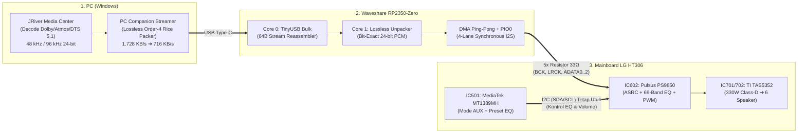

# 🎬 LG HT306 Direct-I2S 5.1/7.1 Lossless 96 kHz USB Bridge (`Waveshare RP2350-Zero`)

🌐 **Bahasa:** [English](./README.md) | **Bahasa Indonesia**

[](LICENSE)
[](https://www.waveshare.com/rp2350-zero.htm)
[](docs/02_Lossless_96kHz_Codec_Specification.id.md)
[-orange.svg)](docs/01_Hardware_Architecture_and_Mod_Guide.id.md)
[](docs/04_Build_Flash_and_JRiver_Setup.id.md)

**Jembatan Audio Digital Multichannel (*Direct-to-PWM Processor*) berbasis `Waveshare RP2350-Zero` untuk mengubah Home Theater DVD LG HT306 (`HT306SU` / `HT306SF` / `HT306PD`) menjadi sistem Surround 5.1/7.1 murni digital hingga `96 kHz / 24-bit Lossless` dari PC (JRiver Media Center) — sambil tetap mempertahankan 100% fitur Hardware EQ bawaan LG.**

---

## 1. Tentang Proyek Ini

Home Theater **LG HT306** memiliki penguat daya *Full-Digital Class-D* **`330W RMS`** (berbasis prosesor PWM 8-kanal **`Pulsus PS9850` / `IC602`** dan *power stage* **`TI TAS5352`**), namun bawaan pabriknya hanya menyediakan input analog stereo (`AUX` RCA) tanpa input optik/HDMI multichannel.

Proyek ini memotong jalur analog tersebut dan menyuntikkan **6-Channel Digital I2S (`BCK`, `LRCK`, `ADATA0..2`)** secara langsung dari PC ke kaki input **`IC602 (Pulsus PS9850)`** menggunakan **`Waveshare RP2350-Zero`**:
* **100% Murni Digital (*Bit-Perfect*):** Tanpa konversi DAC/ADC analog sedikit pun.
* **Menembus Batas USB 1.1 Full-Speed untuk `96 kHz / 24-bit 5.1`:** Memadatkan aliran `1.728,0 KB/detik` menjadi **`716,1 KB/detik` (`41,4%`)** menggunakan algoritma *Real-Time Lossless FLAC Order-4 + Escaped Golomb-Rice* (`0 bit error`, latensi `< 0,03 ms` di `Core 1`).
* **EQ Bawaan LG HT306 Tetap Aktif:** Jalur kontrol **`I2C` (`SDA`/`SCL`)** dari chip utama **`MediaTek MT1389MH` (`IC501`)** dibiarkan utuh sehingga seluruh preset **69-Band Hardware EQ** (*Bass Blast, Natural, Pop, Classic, Volume*) tetap berfungsi lewat remote asli LG.

---

## 2. Cara Kerja & Diagram Arsitektur Garis Besar



1. **Di Sisi PC:** **JRiver Media Center (`DSP Studio`)** mendekode audio film/musik menjadi 6-channel PCM 24-bit (`48 kHz` atau `96 kHz`), lalu **PC Streamer** mengemasnya secara *lossless* setiap `0,5 ms` (`48 sampel`) lengkap dengan checksum `CRC-8`.
2. **Di `Waveshare RP2350-Zero`:** `Core 0` menerima aliran USB dan menyusun paketnya, `Core 1` membuka kompresi kembali menjadi PCM 24-bit yang 100% identik di dalam SRAM, lalu `DMA` + `PIO0` mengeluarkan sinyal I2S ke-6 channel secara serentak pada *falling edge* `BCK`.
3. **Di Mainboard LG HT306:** Sinyal I2S masuk ke `Pad B` dari 5 resistor seri menuju **`IC602 (Pulsus PS9850)`**, diolah oleh **69-Band Hardware EQ** bawaan LG (yang dikontrol oleh `MT1389MH` via `I2C` pada mode `AUX`), lalu diperkuat oleh **`TI TAS5352`** ke 6 speaker.

---

## 3. Ringkasan Pemetaan Pin (`RP2350-Zero` $\rightarrow$ `IC602 Pulsus PS9850`)

| Pin `RP2350-Zero` | Sinyal | Kanal Audio | Titik Sambung di Mainboard LG HT306 (`IC602`) |
| :---: | :--- | :--- | :--- |
| **`GP2`** | `I2S_BCK` | Bit Clock (`64 × Fs`) | Via Resistor `33 Ω` $\rightarrow$ Pad Resistor `BCK` (arah `IC602`) |
| **`GP3`** | `I2S_LRCK` | Word Select (`Fs`) | Via Resistor `33 Ω` $\rightarrow$ Pad Resistor `LRCK` (arah `IC602`) |
| **`GP4`** | `I2S_ADATA0` | **Front L & Front R** | Via Resistor `33 Ω` $\rightarrow$ Pad Resistor `ADATA0` (arah `IC602`) |
| **`GP5`** | `I2S_ADATA1` | **Surround L & Surround R** | Via Resistor `33 Ω` $\rightarrow$ Pad Resistor `ADATA1` (arah `IC602`) |
| **`GP6`** | `I2S_ADATA2` | **Center & Subwoofer (LFE)** | Via Resistor `33 Ω` $\rightarrow$ Pad Resistor `ADATA2` (arah `IC602`) |
| **`GP7` / `GP8` / `GP9`** | Ekspansi | `ADATA3` (7.1) / `MUX` / `IR` | *(Opsional)* Ekspansi 7.1, Switch `74LVC157`, & Remote LG |
| **`GND`** | `Ground` | Referensi Digital (`3.3V`) | Titik **`GND` Digital** di dekat `IC602` pada Mainboard HT306 |

---

## 4. Quick Start (Build, Flash, & Verifikasi)

```powershell
# 1. Jalankan Verifikasi End-to-End (Codec Bit-Perfect, PIO 4-Lane, & USB 64-Byte Reassembly)
python tests/verify_end_to_end.py

# 2. Compile Firmware menjadi ht306_rp2350_zero.uf2 (Membutuhkan Pico SDK v2.0+)
cmake -B firmware/build -S firmware -DPICO_BOARD=pico2 -DCMAKE_BUILD_TYPE=Release
cmake --build firmware/build --config Release -j
```
* **Cara Flash:** Tahan tombol **`BOOT`** pada `RP2350-Zero` saat mencolokkan USB Type-C ke PC, lalu salin file **`firmware/build/ht306_rp2350_zero.uf2`** ke drive **`RP2350`** yang muncul.

---

## 5. Dokumentasi Teknis Lengkap (`docs/`)

Seluruh penjelasan teknis mendalam telah dipisahkan ke dalam dokumen tersendiri di direktori **[`docs/`](docs/)**:

| Dokumen | Isi Penjelasan Detail |
| :--- | :--- |
| 📄 **[01_Hardware_Architecture_and_Mod_Guide.id.md](docs/01_Hardware_Architecture_and_Mod_Guide.id.md)** | Bedah chip mainboard LG HT306, anatomi **5 resistor seri SMD** (*no trace cutting*), serta alasan mengapa mode **`AUX`** & settingan **`2 to 5.1 (PLII)` / EQ Bawaan** tidak bentrok dengan sinyal 5.1 PC. |
| 📄 **[02_Lossless_96kHz_Codec_Specification.id.md](docs/02_Lossless_96kHz_Codec_Specification.id.md)** | Rumus matematis **Single-Pass FLAC Order-4 Linear Predictor**, **ZigZag Mapping**, **Escaped Golomb-Rice**, dan rincian **Header Paket 14-Byte (`HT306_LosslessHeader_t`)**. |
| 📄 **[03_PIO_4Lane_I2S_and_DualCore_DMA.id.md](docs/03_PIO_4Lane_I2S_and_DualCore_DMA.id.md)** | Diagram sekuens timing **`i2s_multi.pio`** pada *falling edge* `BCK`, algoritma *4-Lane Nibble Bit-Interleaver*, dan arsitektur **Wait-Free SPSC Chained Ping-Pong DMA** di SRAM. |
| 📄 **[04_Build_Flash_and_JRiver_Setup.id.md](docs/04_Build_Flash_and_JRiver_Setup.id.md)** | Panduan lengkap kompilasi `.uf2`, cara *flash* ke `Waveshare RP2350-Zero`, hasil benchmark pengujian, dan pengaturan **JRiver Media Center (`DSP Studio`)**. |

---

## 6. Struktur Direktori

```text
HomeTheather/
├── README.md                              # Ringkasan proyek & navigasi utama (Bahasa Inggris)
├── README.id.md                           # Ringkasan proyek & navigasi utama (Bahasa Indonesia)
├── LICENSE                                # Lisensi Open-Source MIT
├── docs/                                  # Dokumentasi teknis mendalam (Bilingual: EN & ID)
├── firmware/                              # Firmware C/PIO untuk Waveshare RP2350-Zero
├── pc_streamer/                           # Modul pengirim paket Lossless 96 kHz dari PC (JRiver)
└── tests/
    └── verify_end_to_end.py               # Suite verifikasi matematis & simulasi hardware
```

---

## 7. Inspirasi & Referensi Proyek Serupa (*Prior Art*)

* **[`tierneytim/Pico-USB-audio`](https://github.com/tierneytim/Pico-USB-audio):** Pelopor 8-Channel Multi-Lane I2S pada Raspberry Pi Pico (`48 kHz`), yang kami kembangkan lebih lanjut dengan *Core 1 Lossless Order-4 Golomb-Rice Unpacker* agar menembus **`96 kHz / 24-bit 5.1`**.
* **[`xiph/flac`](https://github.com/xiph/flac)** & **[`dbry/WavPack`](https://github.com/dbry/WavPack):** Inspirasi matematis prediktor polinomial linear Orde-4 dan pengodean residual Golomb-Rice.
* **[`raspberrypi/pico-extras`](https://github.com/raspberrypi/pico-extras)** & **[`hathach/tinyusb`](https://github.com/hathach/tinyusb):** Fondasi *Chained Ping-Pong DMA* + `PIO` dan USB Device stack pada `RP2350`.

---

## 8. Lisensi (MIT License)

Proyek ini dilisensikan di bawah **[MIT License](LICENSE)** — bebas digunakan, dimodifikasi, dan dikembangkan untuk keperluan pribadi maupun komersial.
