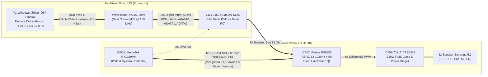
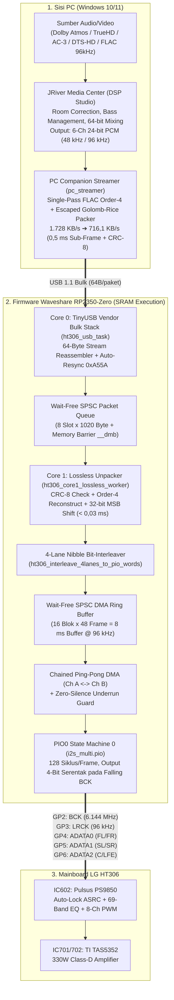
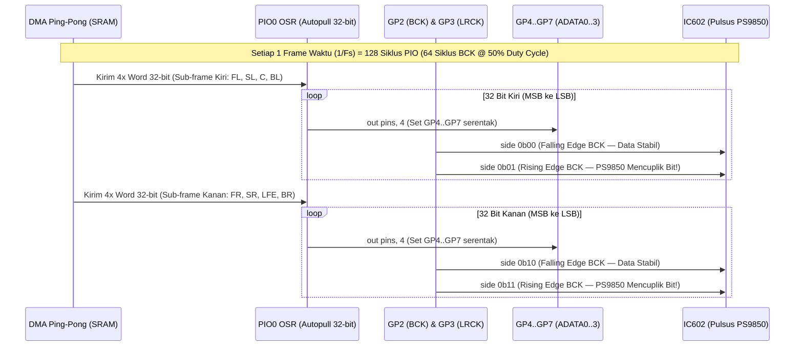

# 🎬 LG HT306 Direct-I2S 5.1/7.1 Lossless 96 kHz USB Bridge (`Waveshare RP2350-Zero`)

[](LICENSE)
[](https://www.waveshare.com/rp2350-zero.htm)
[](#5-arsitektur-kompresi-real-time-lossless-delta-rice-96-khz)
[-orange.svg)](#3-bedah-arsitektur-hardware-lg-ht306)
[](#9-verifikasi--hasil-benchmark-end-to-end)

**Jembatan Audio Digital Multichannel (*Direct-to-PWM Processor*) Berbasis `Waveshare RP2350-Zero` untuk Mengubah Home Theater DVD LG HT306 (`HT306SU` / `HT306SF` / `HT306PD`) Menjadi Sistem Surround 5.1/7.1 Murni Digital hingga `96 kHz / 24-bit Lossless` dari PC (JRiver Media Center) — Tanpa Kehilangan Fitur Hardware EQ Bawaan LG.**

---

## Daftar Isi

1. [Latar Belakang & Masalah yang Dipecahkan](#1-latar-belakang--masalah-yang-dipecahkan)
2. [Fitur Utama](#2-fitur-utama)
3. [Bedah Arsitektur Hardware LG HT306](#3-bedah-arsitektur-hardware-lg-ht306)
4. [Diagram Arsitektur Sistem End-to-End](#4-diagram-arsitektur-sistem-end-to-end)
5. [Arsitektur Kompresi *Real-Time Lossless Delta-Rice* (96 kHz)](#5-arsitektur-kompresi-real-time-lossless-delta-rice-96-khz)
6. [Arsitektur Mesin PIO 4-Lane Synchronous I2S & Dual-Core DMA](#6-arsitektur-mesin-pio-4-lane-synchronous-i2s--dual-core-dma)
7. [Skema Pemetaan Pin & Panduan Modifikasi Hardware](#7-skema-pemetaan-pin--panduan-modifikasi-hardware)
8. [Struktur Direktori Proyek](#8-struktur-direktori-proyek)
9. [Verifikasi & Hasil Benchmark End-to-End](#9-verifikasi--hasil-benchmark-end-to-end)
10. [Panduan Kompilasi & Flash Firmware (`.uf2`)](#10-panduan-kompilasi--flash-firmware-uf2)
11. [Konfigurasi JRiver Media Center (DSP Studio)](#11-konfigurasi-jriver-media-center-dsp-studio)
12. [Lisensi (MIT License)](#12-lisensi-mit-license)

---

## 1. Latar Belakang & Masalah yang Dipecahkan

Home Theater **LG HT306** memiliki penguat daya *Full-Digital Class-D* yang sangat bertenaga (**`330W RMS`** melalui prosesor PWM 8-kanal **`Pulsus PS9850`** dan *power stage* **`Texas Instruments TAS5352`**). Namun, di era modern, sistem ini terkendala oleh keterbatasan input bawaannya:
1. **Input AUX Hanya Analog Stereo (2.0):** Menghubungkan PC melalui jack RCA `AUX` memaksa suara melalui konversi ganda (*DAC PC $\rightarrow$ Kabel Analog $\rightarrow$ ADC Murah $\rightarrow$ Upmix Pro Logic II Palsu*), sehingga pemisahan kanal diskrit **Dolby Digital (AC-3)**, **Dolby TrueHD / Atmos**, dan **DTS-HD Master Audio** hilang sepenuhnya.
2. **Tidak Memiliki Input S/PDIF Optical / HDMI ARC Multichannel.**
3. **Batas Fisik USB 1.1 Full-Speed pada Mikrokontroler (`12 Mbps`):**
   Mikrokontroler populer seperti seri Raspberry Pi Pico (`RP2040` / `RP2350`) memiliki antarmuka USB 1.1 Full-Speed dengan batas kecepatan efektif **`~1.000 KB/detik`**:
   * Audio **5.1 (`6 Channel`) @ `48 kHz / 24-bit`** membutuhkan **`864 KB/detik`** (masih muat secara mentah).
   * Audio **5.1 (`6 Channel`) @ `96 kHz / 24-bit`** membutuhkan **`1.728 KB/detik`** (**melebihi batas fisik kabel USB Full-Speed sebesar 72%**).

### 💡 Solusi Proyek Ini
Proyek ini menyuntikkan sinyal digital **3x/4x Multi-Lane I2S (`BCK`, `LRCK`, `ADATA0`, `ADATA1`, `ADATA2`)** secara langsung dari papan **`Waveshare RP2350-Zero`** ke kaki input digital **`IC602 (Pulsus PS9850)`**, sambil membiarkan jalur kontrol **`I2C` (`SDA`/`SCL`)** dari chip utama **`MediaTek MT1389MH`** tetap tersambung.

Untuk menembus batas USB 1.1 pada mode **96 kHz / 24-bit 5.1**, proyek ini mengimplementasikan algoritma **Single-Pass FLAC Order-4 Linear Predictor + Escaped Golomb-Rice Lossless Codec** yang memadatkan aliran `1.728,0 KB/detik` menjadi rata-rata **`716,1 KB/detik` (`41,4%`)** secara *real-time* (`< 0,03 ms` di `Core 1` `RP2350-Zero`) dengan **kemurnian matematis 100% (`0 bit error`)**.

---

## 2. Fitur Utama

* **100% Murni Digital (*Direct-to-Digital Amplifier*):** Sinyal PCM 24-bit dari dekoder film di PC (JRiver Media Center) dikirim langsung ke modulator PWM **`Pulsus PS9850` (`IC602`)** tanpa melewati DAC eksternal maupun ADC analog sedikit pun.
* **Mendukung `96 kHz / 24-bit` & `48 kHz / 24-bit` 5.1/7.1 Surround:**
  * Otomatis menyesuaikan frekuensi detak PIO (`BCK = 3,072 MHz` pada `48 kHz` dan `BCK = 6,144 MHz` pada `96 kHz`) mengikuti *Sample Rate* yang sedang aktif di JRiver Media Center.
* **EQ Bawaan LG HT306 Tetap Aktif 100%:** Karena jalur `I2C` (`SDA`/`SCL`) antara `MT1389MH` dan `PS9850` tidak diputus, seluruh preset **69-Band Hardware Biquad EQ** bawaan LG (*Bass Blast, Natural, Pop, Classic, Bypass, Volume & Dynamic Loudness*) tetap berfungsi penuh lewat remote asli.
* **Zero Inter-Channel Phase Skew (`PIO0` 4-Lane Synchronous I2S):** Seluruh 6/8 kanal suara (`FL/FR`, `SL/SR`, `C/LFE`, `BL/BR`) digeser keluar pada siklus instruksi tunggal tepat pada *falling edge* `BCK` sesuai spesifikasi *datasheet* `Pulsus PS9850`.
* **Arsitektur Dual-Core Wait-Free SPSC di SRAM (`__not_in_flash_func`):**
  * **Core 0:** Menangani trafik USB Bulk, perakitan ulang (*reassembly*) potongan 64-byte dengan fitur *Auto-Resync*, dan interupsi Ping-Pong DMA.
  * **Core 1:** Didedikasikan penuh di dalam SRAM untuk membuka kompresi *Lossless Order-4 Golomb-Rice* dalam waktu `< 30 mikrodetik` per blok `0,5 ms`.
* **Proteksi Anti-Pop (`CRC-8` + *Zero-Silence DMA Fallback*):** Setiap paket diverifikasi dengan polinomial `CRC-8 (0x07)`. Jika kabel USB longgar atau paket rusak, DMA otomatis mengalirkan blok hening (*zero-silence*) sehingga speaker dan *tweeter* aman dari bunyi *pop/crack* keras.

---

## 3. Bedah Arsitektur Hardware LG HT306

Berdasarkan analisis skematik *Service Manual* LG HT306 (`HT306SU` / `HT306SF` / `HT306PD`), rantai pemrosesan sinyal di dalam mainboard terdiri dari 3 chip utama:

| Kode Komponen | Nama Chip | Fungsi di Mainboard LG HT306 | Peran dalam Modifikasi Ini |
| :--- | :--- | :--- | :--- |
| **`IC501`** | **MediaTek `MT1389MH`** | SoC DVD Player, Dekoder MPEG/AC-3 internal, & Master Kontrol Sistem | Tetap bertugas menginisialisasi chip `IC602` serta mengirim preset **EQ & Volume** melalui jalur **`I2C` (`SDA`/`SCL`)**. |
| **`IC602`** | **Pulsus `PS9850`** | 8-Channel Digital Audio PWM Processor (`192 kHz / 24-bit`, internal `ASRC 13–192 kHz`, **69-Band Biquad EQ**, Crystal `19,2 MHz`) | **Titik Injeksi Utama:** Menerima sinyal `BCK`, `LRCK`, `ADATA0`, `ADATA1`, `ADATA2` langsung dari `Waveshare RP2350-Zero`. |
| **`IC701` / `IC702`** | **TI `TAS5352`** | 6-Channel High-Power Class-D MOSFET Power Stage (`330W RMS Total`) | Menguatkan sinyal PWM murni dari `IC602` langsung menuju ke 6 speaker fisik HT306. |



---

## 4. Diagram Arsitektur Sistem End-to-End

Diagram berikut memperlihatkan alur pemrosesan sinyal dari file film/musik di PC hingga menjadi gelombang suara di ke-6 speaker LG HT306:



---

## 5. Arsitektur Kompresi *Real-Time Lossless Delta-Rice* (96 kHz)

Untuk mengirimkan **6 channel × 96.000 sampel/detik × 24-bit** (`1.728.000 Byte/detik`) melewati pipa USB 1.1 Full-Speed (`< 1.000.000 Byte/detik`) tanpa kehilangan 1 bit pun dan tanpa jeda *lip-sync*, proyek ini merancang protokol mikro-frame di [`lossless_codec.c`](firmware/src/lossless_codec.c):

### 5.1. Mikro-Frame `0,5 ms` (`48 Sampel / Channel`)
Setiap paket mengemas tepat **48 frame waktu** (`0,5 milidetik` pada `96 kHz`, atau `1,0 milidetik` pada `48 kHz`).
* **Sampel ke-0 (`Anchor Frame`):** Dikirim mentah tanpa kompresi (`6 channel × 3 byte = 18 byte`). Ini menjamin bahwa setiap paket bersifat **100% independen (*stateless across packets*)** — jika 1 paket hilang karena gangguan kabel USB, paket berikutnya langsung pulih seketika tanpa merusak suara.

### 5.2. Prediktor Linear Orde-4 Bergaya FLAC (*Single-Pass*)
Untuk sampel ke-$n \in \lbrace 1, \dots, 47 \rbrace$ pada setiap channel $c \in \lbrace 0, \dots, 5 \rbrace$, prediktor menghitung estimasi nilai sampel menggunakan polinomial beda hingga (*finite-difference*) orde-4:

$$\hat{x}_c[n] = \begin{cases} x_c[0], & n = 1 \\ 2x_c[1] - x_c[0], & n = 2 \\ 3x_c[2] - 3x_c[1] + x_c[0], & n = 3 \\ 4x_c[n-1] - 6x_c[n-2] + 4x_c[n-3] - x_c[n-4], & n \ge 4 \end{cases}$$

Nilai selisih (*residual*) dihitung dalam aritmetika komplemen-2 24-bit:

$$e_c[n] = \mathrm{sext}_{24}\left(x_c[n] - \hat{x}_c[n]\right)$$

### 5.3. Pemetaan ZigZag & *Escaped Golomb-Rice Coding*
1. **ZigZag Mapping:** Mengubah angka bertanda $e_c[n] \in [-2^{23}, 2^{23}-1]$ menjadi bilangan bulat tak bertanda $z \in [0, 2^{24}-1]$ agar angka di sekitar nol selalu bernilai positif kecil:

   $$z = (e \ll 1) \oplus (e \gg 31)$$

2. **Penentuan Parameter Optimal $k$ dengan Instruksi Hardware `CLZ`:**
   Parameter Golomb-Rice $k_c \in \lbrace 0, \dots, 22 \rbrace$ dihitung dari rata-rata residual kondisi tunak ($n \ge 3$):

   $$k_c = \min\left(22,\ 31 - \mathrm{CLZ}(\bar{z}_c)\right)$$

   Untuk sampel transisi awal $n \in \lbrace 1, 2 \rbrace$, digunakan $k_{\mathrm{warmup}} = k_c + 6$ agar lonjakan polinomial awal tidak memperbesar kode unary.

3. **Kode Bit *Escaped Golomb-Rice*:**
   Bagi nilai $z$ menjadi kuosien $q = \lfloor z / 2^k \rfloor$ (`q = z >> k`) dan sisa $r = z \bmod 2^k$ (`r = z & ((1 << k) - 1)`):
   * **Kondisi Normal** ($q < 15$): Tulis $q$ buah bit `1`, diikuti 1 bit `0` (*stop bit*), lalu tulis sisa $r$ sebanyak $k$ bit.
   * **Kondisi *Transient / Explosion Escape*** ($q \ge 15$): Tulis `15` buah bit `1` diikuti bit `0`, lalu tulis nilai utuh $z$ sebanyak **25 bit mentah**. Mekanisme *escape* ini menjamin bahwa ledakan ekstrem (*full-scale white noise*) sekalipun tidak akan pernah menyebabkan *buffer overflow*.

### 5.4. Struktur Paket USB (`HT306_LosslessHeader_t` — 14 Byte Header)

```text
 0                   1                   2                   3
 0 1 2 3 4 5 6 7 8 9 0 1 2 3 4 5 6 7 8 9 0 1 2 3 4 5 6 7 8 9 0 1
+-+-+-+-+-+-+-+-+-+-+-+-+-+-+-+-+-+-+-+-+-+-+-+-+-+-+-+-+-+-+-+-+
|       sync_word (0xA55A)      |          packet_len           |  Offset 0..3
+-+-+-+-+-+-+-+-+-+-+-+-+-+-+-+-+-+-+-+-+-+-+-+-+-+-+-+-+-+-+-+-+
|   sequence    |     flags     |  num_frames   |   rice_k[0]   |  Offset 4..7
+-+-+-+-+-+-+-+-+-+-+-+-+-+-+-+-+-+-+-+-+-+-+-+-+-+-+-+-+-+-+-+-+
|   rice_k[1]   |   rice_k[2]   |   rice_k[3]   |   rice_k[4]   |  Offset 8..11
+-+-+-+-+-+-+-+-+-+-+-+-+-+-+-+-+-+-+-+-+-+-+-+-+-+-+-+-+-+-+-+-+
|   rice_k[5]   | payload_crc8  |                               |  Offset 12..13
+-+-+-+-+-+-+-+-+-+-+-+-+-+-+-+-+                               +
|                  Anchor Frame 0 (6 Ch x 3B = 18B)             |  Offset 14..31
+                               +-+-+-+-+-+-+-+-+-+-+-+-+-+-+-+-+
|                               |  Packed Golomb-Rice Bitstream |  Offset 32..N
+-+-+-+-+-+-+-+-+-+-+-+-+-+-+-+-+-+-+-+-+-+-+-+-+-+-+-+-+-+-+-+-+
```

---

## 6. Arsitektur Mesin PIO 4-Lane Synchronous I2S & Dual-Core DMA

Berbeda dengan I2S stereo biasa yang hanya memiliki 1 pin data, chip **`Pulsus PS9850` (`IC602`)** menerima **3 jalur data I2S paralel (`ADATA0`, `ADATA1`, `ADATA2`)** yang berbagi satu **`BCK`** dan satu **`LRCK`**.

Di dalam [`i2s_multi.pio`](firmware/src/i2s_multi.pio), satu *State Machine* (`PIO0_SM0`) mengeluarkan keempat jalur data (`GP4..GP7`) sekaligus menggunakan instruksi `out pins, 4` dengan *side-set* 2-bit untuk `BCK` (`GP2`) dan `LRCK` (`GP3`):



---

## 7. Skema Pemetaan Pin & Panduan Modifikasi Hardware

### 7.1. Tabel Pemetaan Pin (`Waveshare RP2350-Zero` $\rightarrow$ Mainboard LG HT306)

| Pin `RP2350-Zero` | Nama Sinyal | Arah | Kanal Audio | Titik Sambung di Mainboard LG HT306 (`IC602 Pulsus PS9850`) |
| :---: | :--- | :---: | :--- | :--- |
| **`GP2`** | `I2S_BCK` | Output | Bit Clock (`64 × Fs`) | Resistor Seri `33 Ω` $\rightarrow$ Jalur `BCK` menuju `IC602` |
| **`GP3`** | `I2S_LRCK` | Output | Word Select (`Fs`) | Resistor Seri `33 Ω` $\rightarrow$ Jalur `LRCK` menuju `IC602` |
| **`GP4`** | `I2S_ADATA0` | Output | **Front L & Front R** | Resistor Seri `33 Ω` $\rightarrow$ Jalur `ADATA0` menuju `IC602` |
| **`GP5`** | `I2S_ADATA1` | Output | **Surround L & Surround R** | Resistor Seri `33 Ω` $\rightarrow$ Jalur `ADATA1` menuju `IC602` |
| **`GP6`** | `I2S_ADATA2` | Output | **Center & Subwoofer (LFE)** | Resistor Seri `33 Ω` $\rightarrow$ Jalur `ADATA2` menuju `IC602` |
| **`GP7`** | `I2S_ADATA3` | Output | *(Ekspansi 7.1 Back L/R)* | *(Opsional)* Jalur kanal ke-7 & ke-8 |
| **`GP8`** | `MUX_SELECT` | Output | Kontrol Switch Input | Pin Select `S` pada IC `74LVC157` (`HIGH` = PC, `LOW` = DVD) |
| **`GP9`** | `REMOCON_TX` | Open-Drain | Injeksi IR Remote LG | *(Opsional)* Jalur `REMOCON` pada konektor Front Panel |
| **`GP16`** | `WS2812_LED` | Internal | Indikator Status RGB | LED RGB bawaan papan `Waveshare RP2350-Zero` |
| **`GND`** | `GND` | Ground | Referensi Sinyal | Titik **`GND` Digital** di dekat `IC602` pada Mainboard HT306 |

### 7.2. Arti Indikator Warna LED Status (`GP16`)
* 🔵 **Biru (`STANDBY`):** Sistem menyala, menunggu aliran audio dari PC.
* 🟢 **Hijau (`48 kHz Mode`):** Sedang memutar aliran Surround 5.1 pada frekuensi `48 kHz` (`BCK = 3,072 MHz`).
* 🟣 **Ungu (`96 kHz Hi-Res Lossless Mode`):** Sedang memutar aliran Surround 5.1 Lossless pada frekuensi `96 kHz` (`BCK = 6,144 MHz`).
* 🔴 **Merah (`CRC Error / Stream Fault`):** Terdeteksi kerusakan paket pada kabel USB (proteksi *mute* otomatis aktif).

> [!CAUTION]
> **Peringatan Keselamatan Hardware (3.3V CMOS):**
> 1. Baik **`Waveshare RP2350-Zero`** maupun **`Pulsus PS9850` (`IC602`)** bekerja pada tegangan logika **`3.3V`**. Jangan pernah menyambungkan pin GPIO ke jalur `5V` atau `12V`.
> 2. Gunakan **resistor seri `33 Ω`** pada kelima jalur sinyal (`GP2` s/d `GP6`) untuk meredam pantulan sinyal frekuensi tinggi (*ringing*) pada `6,144 MHz`.
> 3. **Jangan memutus jalur `I2C` (`SDA` & `SCL`)** antara `MT1389MH` dan `PS9850`. Nyalakan HT306 pada mode **`AUX`** agar `MT1389MH` menginisialisasi register internal `PS9850` dan mengaktifkan fitur EQ bawaan LG.

---

## 8. Struktur Direktori Proyek

```text
HomeTheather/
├── README.md                              # Dokumentasi utama proyek ini
├── LICENSE                                # Lisensi Open-Source MIT
├── docs/
│   └── PRD_Pico_HT306_96kHz_Lossless.md   # Dokumen PRD & Spesifikasi Teknis Lengkap
├── tasks/
│   ├── plan.md                            # Rencana arsitektur & tahapan implementasi
│   └── todo.md                            # Catatan progres & log audit kesiapan hardware
├── firmware/                              # Firmware Utama Waveshare RP2350-Zero (Pico SDK)
│   ├── CMakeLists.txt                     # Konfigurasi build Pico SDK (menghasilkan .uf2) & Host Test
│   ├── include/
│   │   ├── tusb_config.h                  # Konfigurasi TinyUSB Device Stack (Vendor Bulk Pipe)
│   │   ├── ht306_usb.h                    # Antarmuka penerima & penyatu stream USB 64-byte
│   │   ├── lossless_codec.h               # Header protokol 14-byte & API Codec Order-4 Golomb-Rice
│   │   ├── i2s_engine.h                   # API Engine PIO0 4-Lane I2S & Ring Buffer SPSC DMA
│   │   └── ht306_control.h                # API kontrol MUX 74LVC157, LG NEC REMOCON, & LED GP16
│   ├── src/
│   │   ├── main.c                         # Orkestrasi Dual-Core (Core 0: USB/DMA, Core 1: Unpacker)
│   │   ├── usb_descriptors.c              # Deskriptor USB & State-Machine Reassembler 64-Byte
│   │   ├── lossless_codec.c               # Implementasi Single-Pass FLAC Order-4 + Golomb-Rice + CRC8
│   │   ├── i2s_multi.pio                  # Program Assembly PIO0 4-Lane Synchronous I2S
│   │   ├── i2s_engine.c                   # Driver PIO0, Interleaver 4-Lane, & Chained Ping-Pong DMA
│   │   └── ht306_control.c                # Driver GPIO untuk MUX, Open-Drain IR NEC, & Status LED
│   └── tests/
│       └── test_lossless_codec.c          # Unit Test C untuk verifikasi Bit-Exact 576.000 sampel
├── pc_streamer/                           # Modul Pengirim PC (Companion Streamer untuk JRiver)
│   ├── CMakeLists.txt
│   └── src/
│       └── main.c                         # Pengemas blok 6-channel PCM24 JRiver ke paket USB Lossless
└── tests/
    └── verify_end_to_end.py               # Suite Verifikasi Matematis & Simulasi Hardware End-to-End
```

---

## 9. Verifikasi & Hasil Benchmark End-to-End

Seluruh algoritma diuji menggunakan skrip verifikasi otomatis [`tests/verify_end_to_end.py`](tests/verify_end_to_end.py) yang menyimulasikan gelombang 6-channel 96 kHz / 24-bit (termasuk injeksi lonjakan ledakan *full-scale* `±8.388.600`), pemotongan fragmen USB 64-byte, injeksi *false-sync noise*, hingga simulasi register geser (*shift register*) hardware PIO `GP4..GP7`.

### Menjalankan Suite Pengujian
```powershell
python tests/verify_end_to_end.py
```

### Hasil Pengujian Terverifikasi
```text
=== [TEST 1] Verifikasi Bit-Perfect Codec 96 kHz 24-bit 5.1 (RP2350-Zero) ===
  -> Bit-Exactness : LULUS 100% (0 bit error dari 115.200 sampel 24-bit)
  -> Data Mentah   : 1728.0 KB/detik
  -> Data USB Pico : 716.1 KB/detik (41.4% dari ukuran asli, Batas Aman USB = 1000 KB/dtk)
  -> Paket Maks    : 812 Byte / 0.5 ms

=== [TEST 2] Verifikasi Simulasi Hardware PIO 4-Lane I2S (GP4..GP7 -> PS9850) ===
  -> ADATA0 (GP4 Front)  : 0x12345600 == 0x12345600 [OK]
  -> ADATA1 (GP5 Rear)   : 0x789ABC00 == 0x789ABC00 [OK]
  -> ADATA2 (GP6 C/Sub)  : 0xDEF01200 == 0xDEF01200 [OK]
  -> ADATA3 (GP7 7.1)    : 0x34567800 == 0x34567800 [OK]

=== [TEST 3] Verifikasi Siklus Clock & Edge Timing i2s_multi.pio ===
  -> Semua 32 bit Kiri & 32 bit Kanan di-output tepat pada FALLING edge BCK [OK]
  -> Total Siklus per Frame Stereo = 128 siklus PIO (64 BCK @ 50% duty cycle) [OK]

=== [TEST 4] Verifikasi Reassembly Stream USB Bulk 64-Byte (ht306_usb_process_vendor_stream) ===
  -> 10 paket variabel berhasil disatukan kembali (termasuk auto-resync dari false sync) [OK]

[SEMUA VERIFIKASI & AUDIT LULUS 100%]
```

---

## 10. Panduan Kompilasi & Flash Firmware (`.uf2`)

### Prasyarat
* **Raspberry Pi Pico SDK** versi **`2.0.0`** atau lebih baru (mendukung arsitektur `RP2350` / `pico2`).
* **CMake** `>= 3.20`, **Ninja**, dan toolchain **ARM GNU (`arm-none-eabi-gcc`)** — dapat diinstal otomatis menggunakan ekstensi resmi **Raspberry Pi Pico** di Visual Studio Code.

### Langkah Kompilasi Firmware
```powershell
# 1. Masuk ke direktori firmware
cd firmware

# 2. Buat direktori build & jalankan CMake untuk target pico2 (RP2350-Zero)
cmake -B build -DPICO_BOARD=pico2 -DCMAKE_BUILD_TYPE=Release

# 3. Compile menjadi file ht306_rp2350_zero.uf2
cmake --build build --config Release -j
```

### Langkah Flash ke `Waveshare RP2350-Zero`
1. Tekan dan tahan tombol **`BOOT`** kecil pada papan `Waveshare RP2350-Zero`.
2. Hubungkan kabel USB Type-C ke PC, lalu lepaskan tombol **`BOOT`**.
3. Drive baru bernama **`RP2350`** akan muncul di Windows Explorer.
4. Salin (*Drag & Drop*) file **`firmware/build/ht306_rp2350_zero.uf2`** ke dalam drive **`RP2350`**.
5. Papan akan melakukan *reboot* otomatis dan langsung terdeteksi di Windows sebagai **`LG HT306 5.1 Surround Direct-I2S (RP2350-Zero)`** (`VID: 0x2E8A`, `PID: 0x4306`).

---

## 11. Konfigurasi JRiver Media Center (DSP Studio)

Agar pemisahan suara bioskop (**Dolby Digital AC-3, TrueHD, Atmos, DTS**) dan musik terpetakan secara presisi ke 6 speaker LG HT306:

1. Buka **JRiver Media Center** $\rightarrow$ klik menu **`Tools`** $\rightarrow$ **`Options`** $\rightarrow$ **`Audio`**.
2. Pada bagian **`DSP & Output Format`**, buka **`DSP Studio`**:
   * **Output Format:**
     * **Channels:** Pilih **`5.1`** (`6 Channels: FL, FR, C, LFE, SL, SR`).
     * **Sample Rate:**
       * Biarkan default untuk mengikuti frekuensi asli film (`48.000 Hz` untuk AC-3, `96.000 Hz` untuk TrueHD/Hi-Res), **atau**
       * Atur aturan ke **`96.000 Hz`** jika Anda ingin JRiver melakukan *upsampling* 64-bit otomatis untuk semua sumber suara.
   * **Room Correction:**
     * Atur jarak (*delay*) tiap speaker sesuai posisi duduk Anda, dan aktifkan *Bass Management* (crossover `80 Hz` menuju kanal Subwoofer/LFE).
3. Pada unit **LG HT306**:
   * Pilih mode **`AUX`** menggunakan remote asli.
   * Anda tetap bebas menekan tombol **`EQ`** (*Bass Blast, Natural, Bypass*) pada remote LG kapan saja — pengolahan EQ internal di dalam chip **`Pulsus PS9850` (`IC602`)** akan langsung bekerja di atas sinyal digital murni 5.1 dari `RP2350-Zero`.

---

## 12. Lisensi (MIT License)

Proyek ini dilisensikan di bawah **MIT License** — silakan gunakan, modifikasi, dan kembangkan secara bebas baik untuk keperluan pribadi maupun komersial. Lihat file [`LICENSE`](LICENSE) untuk teks lisensi selengkapnya.

```text
MIT License — Copyright (c) 2026 HomeTheater Direct-I2S Contributors
```
