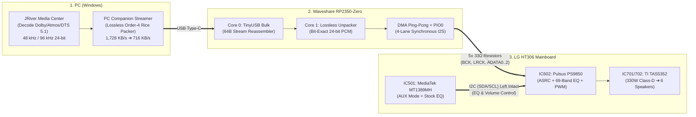

# 🎬 LG HT306 Direct-I2S 5.1/7.1 Lossless 96 kHz USB Bridge (`Waveshare RP2350-Zero`)

<p align="left">
  <strong>Language:</strong> <strong>English</strong> | [Bahasa Indonesia](README.id.md)
</p>

[](LICENSE)
[](https://www.waveshare.com/rp2350-zero.htm)
[](docs/02_Lossless_96kHz_Codec_Specification.md)
[-orange.svg)](docs/01_Hardware_Architecture_and_Mod_Guide.md)
[](docs/04_Build_Flash_and_JRiver_Setup.md)

**A high-performance Multichannel Digital Audio Bridge (*Direct-to-PWM Processor*) powered by `Waveshare RP2350-Zero` to transform legacy LG HT306 DVD Home Theaters (`HT306SU` / `HT306SF` / `HT306PD`) into a pure digital 5.1/7.1 Surround sound system streaming up to `96 kHz / 24-bit Lossless` from PC (JRiver Media Center) — while preserving 100% of LG's stock Hardware EQ features.**

---

## 1. About This Project

The **LG HT306** Home Theater system features a potent **`330W RMS`** *Full-Digital Class-D* power amplifier driven by an 8-channel PWM processor (**`Pulsus PS9850` / `IC602`**) and a **`TI TAS5352`** power stage. However, the stock unit is hobbled by its lack of digital surround inputs, only offering a basic stereo analog `AUX` RCA input.

This project bypasses that analog bottleneck entirely by injecting **6-Channel Digital I2S (`BCK`, `LRCK`, `ADATA0..2`)** directly from the PC into the digital input pins of **`IC602 (Pulsus PS9850)`** using a **`Waveshare RP2350-Zero`**:
* **100% Pure Digital (*Bit-Perfect*):** Completely free from noisy DAC/ADC analog roundtrips.
* **Overcoming USB 1.1 Full-Speed Limits for `96 kHz / 24-bit 5.1`:** Compresses the raw `1,728.0 KB/s` stream down to an average of **`716.1 KB/s` (`41.4%`)** using an ultra-low latency *Real-Time Lossless FLAC Order-4 + Escaped Golomb-Rice Codec* (`0 bit error`, `< 0.03 ms` unpacking latency on `Core 1`).
* **Preserving Stock LG Hardware EQ:** The original **`I2C` (`SDA`/`SCL`)** control lines from the master DVD SoC (**`MediaTek MT1389MH` / `IC501`**) are kept intact so that all **69-Band Hardware Biquad EQ** presets (*Bass Blast, Natural, Pop, Classic, Master Volume*) remain fully controllable via the original LG remote control.

---

## 2. How It Works & High-Level Architecture



1. **Host PC:** **JRiver Media Center (`DSP Studio`)** decodes movie/music tracks into discrete 6-channel 24-bit PCM (`48 kHz` or `96 kHz`), and the **PC Streamer** packages it into lossless `0.5 ms` (`48 frames`) sub-frames guarded by `CRC-8`.
2. **`Waveshare RP2350-Zero`:** `Core 0` receives USB bulk packets and reassembles them, `Core 1` unpacks the bitstream into 100% bit-exact 24-bit PCM in SRAM, and `DMA` + `PIO0` outputs all channels synchronously on the *falling edge* of `BCK`.
3. **LG HT306 Mainboard:** The I2S signals arrive at `Pad B` of the lifted resistors leading into **`IC602 (Pulsus PS9850)`**, pass through LG's **69-Band Hardware EQ** (controlled via `I2C` in `AUX` mode), and are amplified by **`TI TAS5352`** directly to the 6 speakers.

---

## 3. Pinout Mapping Summary (`RP2350-Zero` $\rightarrow$ `IC602 Pulsus PS9850`)

| Pin `RP2350-Zero` | Signal | Audio Channel | Connection on LG HT306 Mainboard (`IC602`) |
| :---: | :--- | :--- | :--- |
| **`GP2`** | `I2S_BCK` | Bit Clock (`64 × Fs`) | Via `33 Ω` Resistor $\rightarrow$ Pad of lifted `BCK` resistor (towards `IC602`) |
| **`GP3`** | `I2S_LRCK` | Word Select (`Fs`) | Via `33 Ω` Resistor $\rightarrow$ Pad of lifted `LRCK` resistor (towards `IC602`) |
| **`GP4`** | `I2S_ADATA0` | **Front L & Front R** | Via `33 Ω` Resistor $\rightarrow$ Pad of lifted `ADATA0` resistor (towards `IC602`) |
| **`GP5`** | `I2S_ADATA1` | **Surround L & Surround R** | Via `33 Ω` Resistor $\rightarrow$ Pad of lifted `ADATA1` resistor (towards `IC602`) |
| **`GP6`** | `I2S_ADATA2` | **Center & Subwoofer (LFE)**| Via `33 Ω` Resistor $\rightarrow$ Pad of lifted `ADATA2` resistor (towards `IC602`) |
| **`GP7` / `GP8` / `GP9`** | Expansion | `ADATA3` (7.1) / `MUX` / `IR` | *(Optional)* 7.1 Expansion, `74LVC157` Switch, & LG Remote injection |
| **`GND`** | `Ground` | Digital Reference (`3.3V`)| Digital **`GND`** point near `IC602` on HT306 mainboard |

---

## 4. Quick Start (Build, Flash, & Verify)

```powershell
# 1. Run End-to-End Verification (Bit-Perfect Codec, 4-Lane PIO, & USB 64-Byte Stream Reassembly)
python tests/verify_end_to_end.py

# 2. Compile Firmware into ht306_rp2350_zero.uf2 (Requires Pico SDK v2.0+)
cmake -B firmware/build -S firmware -DPICO_BOARD=pico2 -DCMAKE_BUILD_TYPE=Release
cmake --build firmware/build --config Release -j
```
* **Flashing Guide:** Hold the **`BOOT`** button on the `RP2350-Zero` while plugging the USB Type-C cable into your PC, then copy **`firmware/build/ht306_rp2350_zero.uf2`** into the mounted **`RP2350`** volume.

---

## 5. Comprehensive Documentation (`docs/`)

Deep technical documentation has been organized into dedicated modules under **[`docs/`](docs/)**:

| Document | Detailed Contents |
| :--- | :--- |
| 📄 **[01_Hardware_Architecture_and_Mod_Guide.md](docs/01_Hardware_Architecture_and_Mod_Guide.md)**<br>*(ID: [Versi Bahasa Indonesia](docs/01_Hardware_Architecture_and_Mod_Guide.id.md))* | Detailed breakdown of LG HT306 ICs, anatomy of the **5 SMD series damping resistors** (*no trace cutting*), and why **`AUX` mode & `2 to 5.1 (PLII)` / Stock EQ** will never interfere with PC 5.1 audio. |
| 📄 **[02_Lossless_96kHz_Codec_Specification.md](docs/02_Lossless_96kHz_Codec_Specification.md)**<br>*(ID: [Versi Bahasa Indonesia](docs/02_Lossless_96kHz_Codec_Specification.id.md))* | Mathematical equations for **Single-Pass FLAC Order-4 Predictor**, **ZigZag Mapping**, **Escaped Golomb-Rice**, and detailed specification of the **14-Byte Packet Header (`HT306_LosslessHeader_t`)**. |
| 📄 **[03_PIO_4Lane_I2S_and_DualCore_DMA.md](docs/03_PIO_4Lane_I2S_and_DualCore_DMA.md)**<br>*(ID: [Versi Bahasa Indonesia](docs/03_PIO_4Lane_I2S_and_DualCore_DMA.id.md))* | Precision clock timing diagrams for **`i2s_multi.pio`** on *falling edge* `BCK`, the *4-Lane Nibble Bit-Interleaver*, and the **Wait-Free SPSC Chained Ping-Pong DMA** engine in SRAM. |
| 📄 **[04_Build_Flash_and_JRiver_Setup.md](docs/04_Build_Flash_and_JRiver_Setup.md)**<br>*(ID: [Versi Bahasa Indonesia](docs/04_Build_Flash_and_JRiver_Setup.id.md))* | Step-by-step firmware build guide, `.uf2` flashing, benchmark test outputs, and **JRiver Media Center (`DSP Studio`)** configuration. |

---

## 6. Directory Structure

```text
HomeTheather/
├── README.md                              # Main overview & navigation (English)
├── README.id.md                           # Main overview & navigation (Bahasa Indonesia)
├── LICENSE                                # MIT Open-Source License
├── docs/                                  # In-depth technical guides (Bilingual: EN & ID)
├── firmware/                              # C/PIO Firmware for Waveshare RP2350-Zero
├── pc_streamer/                           # Host-side 96 kHz Lossless audio streamer (JRiver)
└── tests/
    └── verify_end_to_end.py               # End-to-end mathematical & hardware simulation suite
```

---

## 7. Inspirations & Prior Art

* **[`tierneytim/Pico-USB-audio`](https://github.com/tierneytim/Pico-USB-audio):** Pioneered 8-Channel Multi-Lane I2S on Raspberry Pi Pico (`48 kHz`), which we expanded with a *Core 1 Lossless Order-4 Golomb-Rice Unpacker* to support **`96 kHz / 24-bit 5.1`**.
* **[`xiph/flac`](https://github.com/xiph/flac)** & **[`dbry/WavPack`](https://github.com/dbry/WavPack):** Mathematical foundation for Order-4 linear prediction and Golomb-Rice residual coding.
* **[`raspberrypi/pico-extras`](https://github.com/raspberrypi/pico-extras)** & **[`hathach/tinyusb`](https://github.com/hathach/tinyusb):** Foundation for *Chained Ping-Pong DMA* + `PIO` and USB Device stack on `RP2350`.

---

## 8. License (MIT License)

This project is licensed under the **[MIT License](LICENSE)** — free to use, modify, and distribute for both personal and commercial applications.
