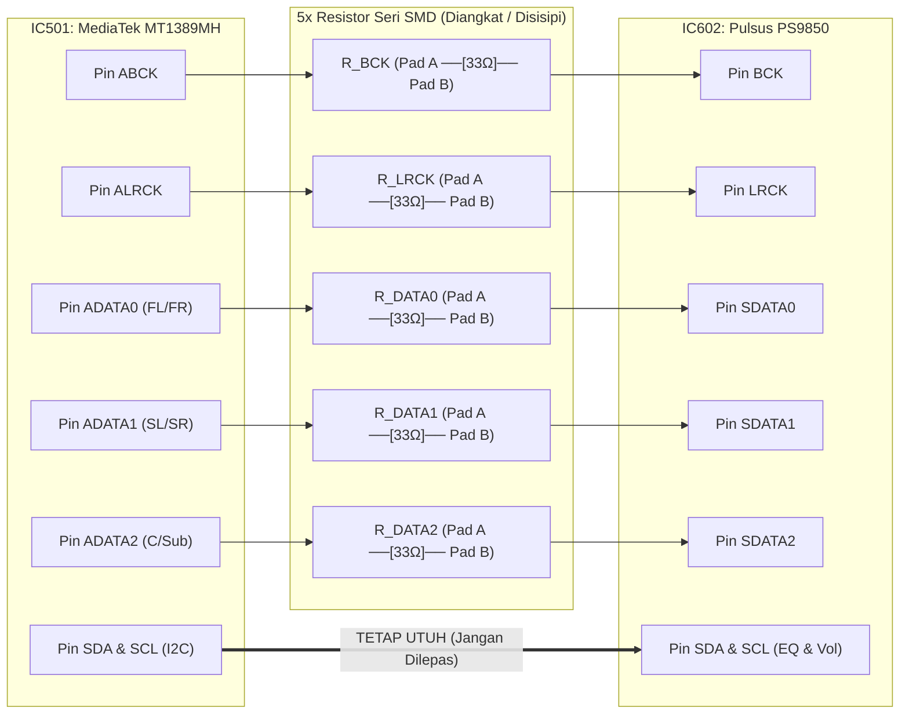
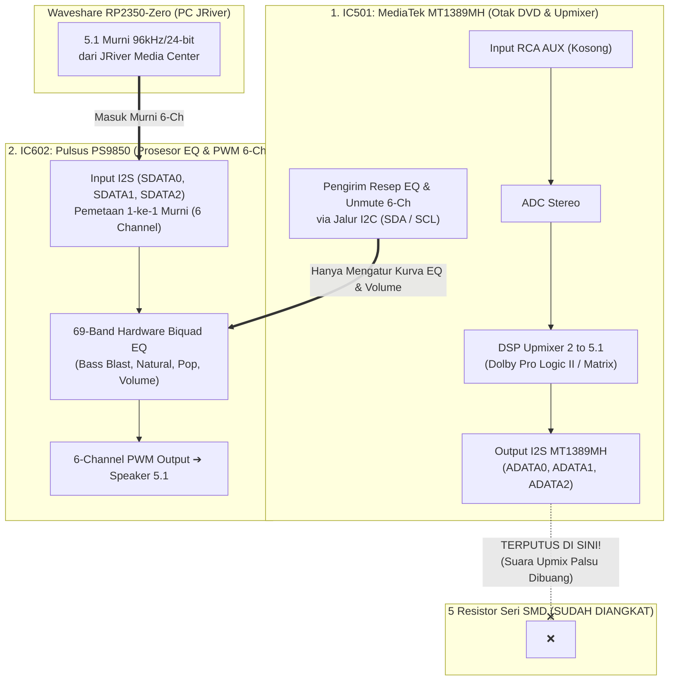

# 1. Bedah Arsitektur Hardware LG HT306 & Panduan Modifikasi Injeksi I2S

🌐 **Bahasa:** [English](./01_Hardware_Architecture_and_Mod_Guide.md) | **Bahasa Indonesia**

[⬅️ Kembali ke README Utama](../README.id.md)

Dokumen ini menjelaskan arsitektur internal mainboard **LG HT306 (`HT306SU` / `HT306SF` / `HT306PD`)**, anatomi 5 resistor seri SMD tempat penyuntikan sinyal I2S dari **`Waveshare RP2350-Zero`**, serta alasan teknis mengapa mode **`AUX`** dan **EQ Bawaan LG HT306 (`2 to 5.1 PLII`, `Bass Blast`, `Natural`)** tetap berfungsi normal tanpa mencampur/merusak suara 5.1 murni dari PC.

---

## 1.1. Rantai Chip Audio di Mainboard LG HT306

Berdasarkan *Service Manual* LG HT306, pemrosesan sinyal di dalam mainboard terbagi ke dalam 3 IC utama:

| Kode IC | Nama Komponen | Fungsi Asli di LG HT306 | Peran dalam Modifikasi Ini |
| :--- | :--- | :--- | :--- |
| **`IC501`** | **MediaTek `MT1389MH`** | SoC DVD Player, Dekoder MPEG/AC-3 internal, Upmixer *Dolby Pro Logic II*, & Mikrokontroler Sistem | Tetap bertugas menginisialisasi `IC602` saat menyala serta mengirim resep **EQ & Master Volume** melalui jalur **`I2C` (`SDA`/`SCL`)**. |
| **`IC602`** | **Pulsus `PS9850`** | 8-Channel Digital Audio PWM Processor (`192 kHz / 24-bit`, internal `ASRC 13–192 kHz`, **69-Band Biquad EQ**, Crystal `19,2 MHz`) | **Titik Injeksi Utama:** Menerima sinyal digital `BCK`, `LRCK`, `ADATA0`, `ADATA1`, `ADATA2` langsung dari `Waveshare RP2350-Zero`. |
| **`IC701` / `IC702`** | **TI `TAS5352`** | 6-Channel High-Power Class-D MOSFET Power Stage (`330W RMS Total`) | Menguatkan sinyal PWM dari `IC602` langsung ke 6 speaker fisik HT306 (`FL, FR, C, Sub, SL, SR`). |

---

## 1.2. Anatomi 5 Resistor Seri SMD Antara `MT1389MH` dan `Pulsus PS9850` (*No Trace Cutting*)

Pada mainboard LG HT306, jalur sinyal digital I2S antara kaki output **`IC501 (MediaTek MT1389MH)`** dan kaki input **`IC602 (Pulsus PS9850)`** hanya dibatasi oleh **1 buah resistor SMD seri (*damping resistor*, `33 Ω – 100 Ω`) pada masing-masing jalur**. Tidak ada komponen aktif atau *level shifter* di tengahnya karena kedua chip sama-sama bekerja pada tegangan **`3.3V CMOS`**.

### Prosedur Injeksi Tanpa Potong Jalur (*No Trace Cutting*)
1. **Setiap resistor SMD memiliki 2 titik timah (`Pad A` & `Pad B`):**
   * **`Pad A`:** Mengarah ke kaki output `MediaTek MT1389MH` (`IC501`).
   * **`Pad B`:** Mengarah langsung ke kaki input `Pulsus PS9850` (`IC602`).
2. **Langkah Penyambungan:**
   * Lepas (atau angkat satu sisi kaki) **5 resistor SMD** khusus jalur `BCK`, `LRCK`, `ADATA0`, `ADATA1`, dan `ADATA2`. Mengangkat resistor ini otomatis memutus sinyal I2S dari `MT1389MH` sehingga tidak beradu tegangan (*bus contention*) dengan `RP2350-Zero`.
   * Solder kabel dari `GP2`..`GP6` **`Waveshare RP2350-Zero`** (melalui resistor seri `33 Ω` pengaman) tepat ke **`Pad B`** (sisi yang mengarah ke `IC602`).
   * *(Opsional)* Jika ingin mempertahankan fungsi pemutar DVD asli sekaligus PC USB, hubungkan `Pad A` ke input `A` IC Multiplexer **`74LVC157`**, `RP2350-Zero` ke input `B`, output `Y` ke `Pad B`, dan pin `Select` ke **`GP8`**.

| Kelompok Jalur | Nama Sinyal | Tindakan pada Resistor SMD di Mainboard |
| :--- | :--- | :--- |
| **5 Jalur Audio I2S** | `BCK`, `LRCK`, `ADATA0`, `ADATA1`, `ADATA2` | ✅ **Angkat ke-5 resistornya**, lalu solder jalur dari `RP2350-Zero` ke **Pad B (arah `IC602`)**. |
| **Jalur Kontrol EQ & Volume** | `SDA`, `SCL` (**`I2C`**), `RESET`, dan `MCLK` (`19,2 MHz` Crystal) | ⛔ **JANGAN DILEPAS / BIARKAN UTUH** agar `MT1389MH` tetap menyalakan `IC602` dan seluruh tombol **EQ & Volume** di remote asli LG tetap berfungsi. |

---

## 1.3. Mengapa Mode `AUX` & Settingan *"2 to 5.1 (`PLII`)"* / EQ Bawaan HT306 Tidak Bentrok dengan Sinyal 5.1 PC?

Di dalam mainboard LG HT306, tugas pemrosesan suara dibagi ke dalam **2 chip yang terpisah**:

1. **Proses *Upmix 2 to 5.1 (`Pro Logic II`)* Berjalan di Dalam `MT1389MH` (`IC501`), Bukan di `PS9850` (`IC602`):**
   * Saat Anda memilih mode `AUX` dan menyalakan settingan *2 to 5.1*, chip `MT1389MH` memang mencoba mengolah input analog RCA (yang kosong) menjadi 6 channel pada kaki output I2S-nya.
   * **Namun karena ke-5 resistor seri I2S dari `MT1389MH` sudah diangkat**, sinyal *upmix* dari `MT1389MH` tersebut **berhenti di kaki resistor yang terangkat dan terbuang sepenuhnya**.
2. **`Pulsus PS9850` (`IC602`) Bekerja Secara *1-to-1 Discrete 6-Channel*:**
   * Chip `Pulsus PS9850` **tidak memiliki pencampur Pro Logic II**. Kaki inputnya (`SDATA0`, `SDATA1`, `SDATA2`) selalu meneruskan 6 kanal diskrit dari `RP2350-Zero` secara murni (`FL/FR`, `SL/SR`, `C/Sub`) melewati **69-Band Hardware Biquad EQ** menuju penguat daya `TAS5352`.

### Efek Tiap Mode EQ / Sound Mode di Remote LG Saat Posisi `AUX`

| Settingan EQ / Mode di Remote LG (Saat `AUX`) | Perintah yang Dikirim `MT1389MH` ke `PS9850` via `I2C` | Hasil Akhir pada Suara 5.1 dari `RP2350-Zero` |
| :--- | :--- | :--- |
| **`BASS BLAST` / `NATURAL` / `POP` / `CLASSIC` / `PLII MOVIE` (Mode 5.1)** | Membuka (*unmute*) seluruh **6 channel amplifier** (`FL, FR, C, Sub, SL, SR`) di `PS9850` + memuat kurva **69-Band EQ** bawaan LG. | ✅ **TERBAIK & NORMAL 100%:** Suara tetap **murni diskrit 5.1 dari JRiver** (tidak tercampur sama sekali), ditambah karakter bass & warna suara khas LG HT306. |
| **`BYPASS` (Mode 2.0 Stereo Murni)** | Pada sebagian firmware LG, mode `BYPASS` di posisi `AUX` memerintahkan `PS9850` via `I2C` untuk me-*mute* speaker `Center` & `Rear` (karena mengira input `AUX` hanya stereo 2.0). | ⚠️ **Hindari memilih `BYPASS` jika speaker belakang ikut mati.** Gunakan `NATURAL` atau `PLII MOVIE` agar ke-6 kanal di `PS9850` selalu aktif penuh. |
| **`SPEAKER LEVEL` & `VOLUME` (`+`/`-`)** | Mengatur penguatan (*gain* dB) per kanal (`FL, FR, C, SW, SL, SR`) di dalam register `PS9850`. | ✅ **Tetap berfungsi 100%** (level Subwoofer/Center dapat diatur dari remote asli LG maupun dari JRiver). |
