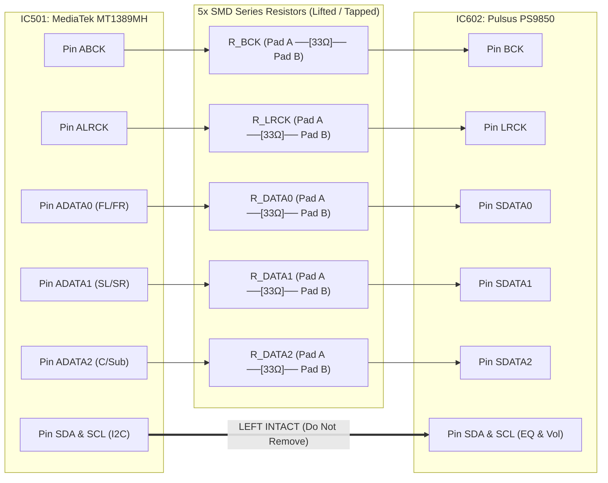
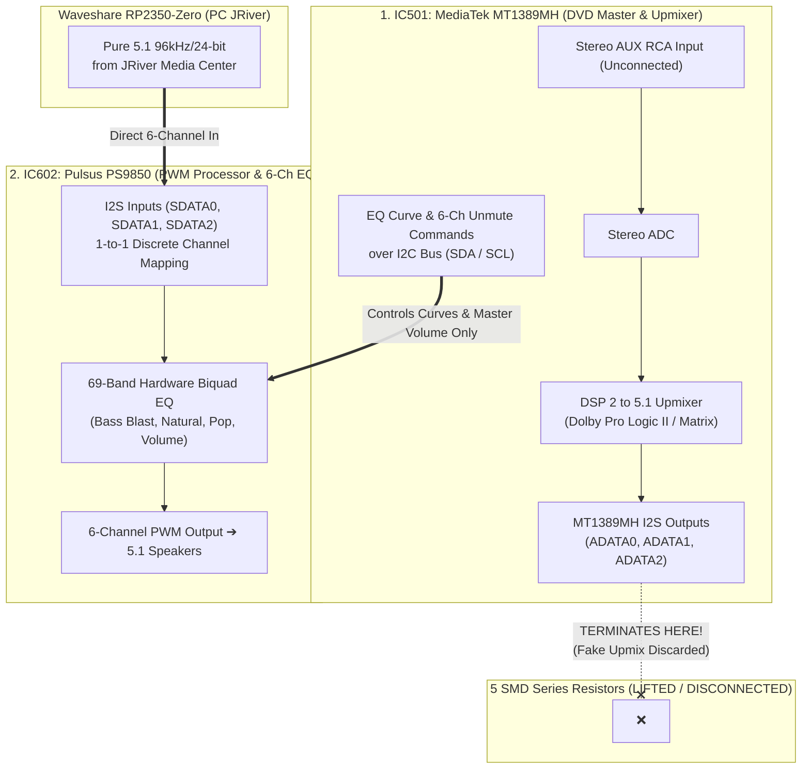

# 1. LG HT306 Hardware Architecture & Direct-I2S Injection Guide

🌐 **Language:** **English** | [Bahasa Indonesia](./01_Hardware_Architecture_and_Mod_Guide.id.md)

[⬅️ Back to Main README](../README.md)

This document details the internal hardware architecture of the **LG HT306 (`HT306SU` / `HT306SF` / `HT306PD`)** mainboard, the physical layout of the 5 series SMD damping resistors tapped for **`Waveshare RP2350-Zero`** I2S injection, and the technical explanation of why **`AUX` mode** and **Stock LG Hardware EQ (`2 to 5.1 PLII`, `Bass Blast`, `Natural`)** will never alter, downmix, or interfere with pure 5.1 multichannel audio streamed from the PC.

---

## 1.1. LG HT306 Mainboard Audio IC Chain

According to the official LG HT306 *Service Manual*, signal processing across the mainboard is handled by three primary integrated circuits:

| IC Ref | Component | Stock Role in LG HT306 | Role in This Direct-I2S Project |
| :--- | :--- | :--- | :--- |
| **`IC501`** | **MediaTek `MT1389MH`** | DVD SoC, internal MPEG/AC-3 decoder, *Dolby Pro Logic II* matrix upmixer, & System Master MCU | Remains powered to initialize `IC602` at boot and dispatch **Hardware EQ & Master Volume** registers over the **`I2C` (`SDA`/`SCL`)** bus. |
| **`IC602`** | **Pulsus `PS9850`** | 8-Channel Digital Audio PWM Processor (`192 kHz / 24-bit`, internal `ASRC 13–192 kHz`, **69-Band Biquad EQ**, `19.2 MHz` Crystal) | **Primary Injection Target:** Receives synchronous digital `BCK`, `LRCK`, `ADATA0`, `ADATA1`, and `ADATA2` lines directly from the `Waveshare RP2350-Zero`. |
| **`IC701` / `IC702`** | **TI `TAS5352`** | 6-Channel High-Power Class-D MOSFET Power Stage (`330W RMS Total`) | Directly drives the 6 physical HT306 speakers (`FL, FR, C, Sub, SL, SR`) from `IC602`'s PWM outputs. |

---

## 1.2. Anatomy of the 5 SMD Series Damping Resistors (*No Trace Cutting*)

On the LG HT306 PCB, the digital I2S lines running between the output pins of **`IC501 (MediaTek MT1389MH)`** and the input pins of **`IC602 (Pulsus PS9850)`** are bridged exclusively by **a single SMD series resistor (`33 Ω – 100 Ω` damping resistor) per line**. There are no active buffers, switches, or level shifters in between, as both ICs operate on native **`3.3V CMOS`** logic.

### Clean Injection Procedure (*No Trace Cutting*)
1. **Each SMD Resistor Features Two Solder Pads (`Pad A` & `Pad B`):**
   * **`Pad A`:** Leads towards the output pins of `MediaTek MT1389MH` (`IC501`).
   * **`Pad B`:** Leads directly into the input pins of `Pulsus PS9850` (`IC602`).
2. **Wiring Steps:**
   * De-solder (or tilt up on one side) the **5 SMD resistors** for `BCK`, `LRCK`, `ADATA0`, `ADATA1`, and `ADATA2`. Lifting them physically disconnects the I2S outputs of `MT1389MH`, eliminating bus contention.
   * Solder jumper wires from `GP2`..`GP6` of the **`Waveshare RP2350-Zero`** (via `33 Ω` protection resistors) directly to **`Pad B`** (the pads leading into `IC602`).
   * *(Optional Dual-Mode)* To preserve stock DVD playback alongside PC USB, wire `Pad A` into input `A` of a **`74LVC157`** multiplexer, the `RP2350-Zero` into input `B`, output `Y` to `Pad B`, and the select pin to **`GP8`**.

| Line Group | Signal Name | Action on Mainboard SMD Resistors |
| :--- | :--- | :--- |
| **5 Audio I2S Lines** | `BCK`, `LRCK`, `ADATA0`, `ADATA1`, `ADATA2` | ✅ **Lift all 5 resistors**, then solder wires from `RP2350-Zero` to **Pad B (towards `IC602`)**. |
| **Control & Clock Lines**| `SDA`, `SCL` (**`I2C`**), `RESET`, and `MCLK` (`19.2 MHz` Crystal) | ⛔ **DO NOT DISCONNECT / LEAVE INTACT** so that `MT1389MH` continues to boot `IC602` and respond to remote **Volume & EQ** commands. |

---

## 1.3. Why `AUX` Mode & *"2 to 5.1 (`PLII`)"* / Stock EQ Never Interfere with PC 5.1

Inside the LG HT306 mainboard, audio processing tasks are strictly partitioned between **two separate chips**:

1. **The *2 to 5.1 Upmixer (`Pro Logic II`)* Operates Exclusively in `MT1389MH` (`IC501`), Not in `PS9850` (`IC602`):**
   * When `AUX` mode is selected and 2-to-5.1 upmixing is engaged, `MT1389MH` attempts to synthesise multichannel audio on its own I2S pins.
   * **Because the 5 series resistors have been lifted**, this synthetic audio **terminates on the lifted pads and is discarded completely**.
2. **`Pulsus PS9850` (`IC602`) Functions in Pure *1-to-1 Discrete 6-Channel* Mode:**
   * `Pulsus PS9850` **does not have an onboard matrix upmixer**. Its input pins (`SDATA0`, `SDATA1`, `SDATA2`) pass all 6 discrete channels from the `RP2350-Zero` straight through the **69-Band Hardware Biquad EQ** and into the `TAS5352` power stages.

### Effect of LG Remote EQ / Sound Modes in `AUX` Mode

| Sound Mode on LG Remote (in `AUX`) | Command Sent by `MT1389MH` over `I2C` | Impact on PC 5.1 Audio from `RP2350-Zero` |
| :--- | :--- | :--- |
| **`BASS BLAST` / `NATURAL` / `POP` / `CLASSIC` / `PLII MOVIE` (5.1 Modes)** | Unmutes all **6 amplifier channels** (`FL, FR, C, Sub, SL, SR`) in `PS9850` and loads stock **69-Band Biquad EQ** curves. | ✅ **RECOMMENDED (100% Normal):** PC audio remains **100% discrete 5.1**, enhanced by LG's custom hardware bass boost and tonality. |
| **`BYPASS` (Pure 2.0 Stereo Mode)** | In some LG firmware versions, selecting `BYPASS` while in `AUX` commands `PS9850` to mute `Center` and `Surround` channels. | ⚠️ **Avoid `BYPASS` if surround channels become silent.** Use `NATURAL` or `PLII MOVIE` to keep all 6 channels unmuted. |
| **`SPEAKER LEVEL` & `VOLUME` (`+`/`-`)** | Adjusts individual channel trims (`FL, FR, C, SW, SL, SR`) within `PS9850` registers. | ✅ **Fully Functional 100%:** You can fine-tune Subwoofer or Center volume directly using the original LG remote. |
