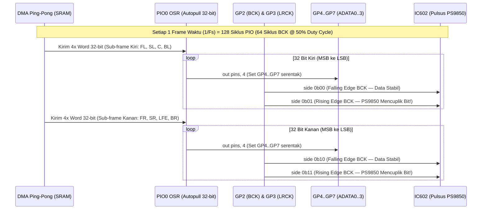
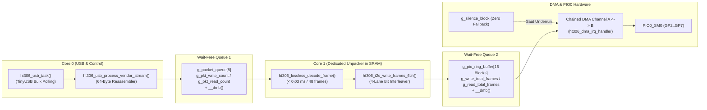

# 3. Arsitektur Mesin `PIO0` 4-Lane Synchronous I2S & Dual-Core Wait-Free DMA

🌐 **Bahasa:** [English](./03_PIO_4Lane_I2S_and_DualCore_DMA.md) | **Bahasa Indonesia**

[⬅️ Kembali ke README Utama](../README.id.md)

Dokumen ini menjelaskan cara kerja generator sinyal I2S multi-lane pada [`firmware/src/i2s_multi.pio`](../firmware/src/i2s_multi.pio), [`firmware/src/i2s_engine.c`](../firmware/src/i2s_engine.c), dan orkestrasi Dual-Core Cortex-M33 pada [`firmware/src/main.c`](../firmware/src/main.c).

---

## 3.1. Sekuens Timing `PIO0` 4-Lane Synchronous I2S (`i2s_multi.pio`)

Berbeda dengan DAC stereo biasa yang hanya memiliki 1 jalur data, chip **`Pulsus PS9850` (`IC602`)** menerima **3 jalur data I2S paralel (`ADATA0`, `ADATA1`, `ADATA2`)** yang berbagi satu **`BCK`** dan satu **`LRCK`**.

Di dalam [`i2s_multi.pio`](../firmware/src/i2s_multi.pio), satu *State Machine* (`PIO0_SM0`) mengeluarkan keempat jalur data (`GP4..GP7`) secara serentak menggunakan instruksi `out pins, 4` dengan *side-set* 2-bit untuk `BCK` (`GP2`) dan `LRCK` (`GP3`):

### Karakteristik Timing Presisi:
* **128 Siklus PIO per Frame Stereo (`64 × BCK` @ 50% Duty Cycle):**
  * Pada `Fs = 48 kHz`: `PIO Clock = 6,144 MHz`, `BCK = 3,072 MHz`, `LRCK = 48,00 kHz`.
  * Pada `Fs = 96 kHz`: `PIO Clock = 12,288 MHz`, `BCK = 6,144 MHz`, `LRCK = 96,00 kHz`.
* **Perubahan Data Tepat pada *Falling Edge* `BCK`:** Seluruh 32 bit Kiri (`side 0b00`) dan 32 bit Kanan (`side 0b10`) dikeluarkan saat `BCK = 0`, sehingga sinyal pada `GP4..GP7` sudah stabil sepenuhnya ketika `BCK` naik ke `1` (`side 0b01` / `side 0b11`) saat `Pulsus PS9850` mencuplik bit.

---

## 3.2. Bit-Interleaving 4-Lane (`ht306_interleave_4lanes_to_pio_words`)

Karena instruksi `out pins, 4` menggeser 4 bit sekaligus dari *Output Shift Register* (`OSR`) menuju pin `GP4..GP7` pada setiap siklus `BCK`, fungsi `ht306_interleave_4lanes_to_pio_words()` di [`i2s_engine.c`](../firmware/src/i2s_engine.c) menyusun setiap bit ke-$b \in \lbrace 31, \dots, 0 \rbrace$ dari 4 kanal ke dalam satu *nibble* 4-bit:

* **Bit 0 (`GP4` - `ADATA0`):** `Front Left` (saat `LRCK=0`) / `Front Right` (saat `LRCK=1`)
* **Bit 1 (`GP5` - `ADATA1`):** `Surround Left` (saat `LRCK=0`) / `Surround Right` (saat `LRCK=1`)
* **Bit 2 (`GP6` - `ADATA2`):** `Center` (saat `LRCK=0`) / `Subwoofer LFE` (saat `LRCK=1`)
* **Bit 3 (`GP7` - `ADATA3`):** `Back Left` (saat `LRCK=0`) / `Back Right` (saat `LRCK=1`)

Setiap 1 waktu cuplik ($1/F_s$) menghasilkan **8 word 32-bit (`32 Byte`)** di dalam *Ring Buffer* DMA (4 word untuk sub-frame Kiri + 4 word untuk sub-frame Kanan).

---

## 3.3. Orkestrasi Dual-Core & Wait-Free SPSC Chained Ping-Pong DMA

Untuk menjamin aliran audio bebas *glitch* tanpa pernah mematikkan interupsi global (`__disable_irq`):

1. **Bebas *Race Condition* (`Wait-Free Monotonic SPSC`):**
   * Baik antrian paket (`Core 0` $\rightarrow$ `Core 1`) maupun *Ring Buffer* I2S (`Core 1` $\rightarrow$ `DMA_IRQ_0`) menggunakan *counter* monotonik terpisah (`write_count` hanya ditulis oleh *Producer*, `read_count` hanya ditulis oleh *Consumer*) yang dipadukan dengan instruksi *Data Memory Barrier* (`__dmb()`).
2. **Keamanan Stack Core 1 (`Static SRAM Allocation`):**
   * Seluruh buffer dekode (`g_core1_decoded_i2s32`) dialokasikan secara statis di SRAM global, sehingga stack `Core 1` (`2 KB`) tetap aman dari *stack overflow*.
3. **Chained Ping-Pong DMA + *Zero-Silence Fallback*:**
   * Dua kanal DMA (`g_dma_chan_a` dan `g_dma_chan_b`) saling memicu (*chain-to*) secara otomatis di tingkat hardware tanpa jeda siklus clock. Jika aliran USB dari PC berhenti, ISR DMA otomatis mengarahkan pembacaan ke `g_silence_block` (berisi nol) agar speaker tidak mengeluarkan bunyi *buzz/pop*.
