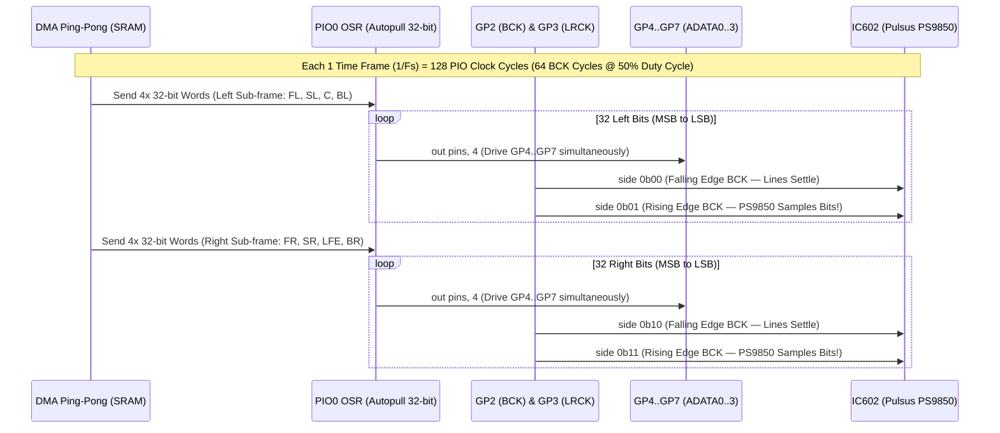
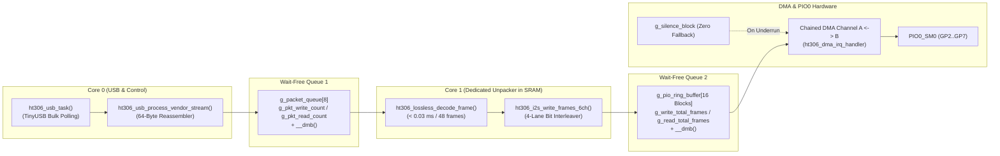

# 3. `PIO0` 4-Lane Synchronous I2S Engine & Dual-Core Wait-Free DMA Architecture

  <strong>Language:</strong> <strong>English</strong> | <a href="03_PIO_4Lane_I2S_and_DualCore_DMA.id.md">Bahasa Indonesia</a>

[⬅️ Back to Main README](../README.md)

This document explains the inner workings of the multi-lane I2S signal generator in [`firmware/src/i2s_multi.pio`](../firmware/src/i2s_multi.pio), the hardware driver in [`firmware/src/i2s_engine.c`](../firmware/src/i2s_engine.c), and the Dual-Core Cortex-M33 orchestration in [`firmware/src/main.c`](../firmware/src/main.c).

---

## 3.1. Precision Timing Sequence: `PIO0` 4-Lane Synchronous I2S (`i2s_multi.pio`)

Unlike conventional stereo audio DACs that accept only a single data lane, the **`Pulsus PS9850` (`IC602`)** processor receives **3 synchronous parallel I2S data lanes (`ADATA0`, `ADATA1`, `ADATA2`)** sharing a common **`BCK`** and **`LRCK`**.

Within [`i2s_multi.pio`](../firmware/src/i2s_multi.pio), a single PIO State Machine (`PIO0_SM0`) drives all four data lines (`GP4..GP7`) simultaneously using the `out pins, 4` instruction, paired with a 2-bit side-set configuration for `BCK` (`GP2`) and `LRCK` (`GP3`):

### Key Timing Characteristics:
* **128 PIO Cycles per Audio Frame (`64 × BCK` at 50% Duty Cycle):**
  * At `Fs = 48 kHz`: `PIO Clock = 6.144 MHz`, `BCK = 3.072 MHz`, `LRCK = 48.00 kHz`.
  * At `Fs = 96 kHz`: `PIO Clock = 12.288 MHz`, `BCK = 6.144 MHz`, `LRCK = 96.00 kHz`.
* **Zero Inter-Channel Skew on Falling Edge `BCK`:** All 32 Left bits (`side 0b00`) and 32 Right bits (`side 0b10`) are driven when `BCK = 0`, ensuring data lines `GP4..GP7` are completely stabilized before `BCK` rises to `1` (`side 0b01` / `side 0b11`) where the `Pulsus PS9850` latches each bit.

---

## 3.2. 4-Lane Bit-Interleaving (`ht306_interleave_4lanes_to_pio_words`)

Because `out pins, 4` shifts 4 bits simultaneously from the *Output Shift Register* (`OSR`) to `GP4..GP7` on every bit clock, the function `ht306_interleave_4lanes_to_pio_words()` in [`i2s_engine.c`](../firmware/src/i2s_engine.c) groups bit $b \in \lbrace 31, \dots, 0 \rbrace$ from each channel into a 4-bit nibble:

* **Bit 0 (`GP4` - `ADATA0`):** `Front Left` (when `LRCK=0`) / `Front Right` (when `LRCK=1`)
* **Bit 1 (`GP5` - `ADATA1`):** `Surround Left` (when `LRCK=0`) / `Surround Right` (when `LRCK=1`)
* **Bit 2 (`GP6` - `ADATA2`):** `Center` (when `LRCK=0`) / `Subwoofer LFE` (when `LRCK=1`)
* **Bit 3 (`GP7` - `ADATA3`):** `Back Left` (when `LRCK=0`) / `Back Right` (when `LRCK=1`)

Each audio sample ($1/F_s$) generates **8 32-bit words (`32 Bytes`)** inside the SRAM ring buffer (4 words for the Left sub-frame + 4 words for the Right sub-frame).

---

## 3.3. Dual-Core Orchestration & Wait-Free SPSC Chained Ping-Pong DMA

To deliver glitch-free audio without ever disabling global interrupts (`__disable_irq`):

1. **Race-Condition-Free (`Wait-Free Monotonic SPSC`):**
   * Both queues (USB Packet Queue `Core 0` $\rightarrow$ `Core 1` and I2S Ring Buffer `Core 1` $\rightarrow$ `DMA_IRQ_0`) rely on independent monotonic write/read counters paired with ARM Cortex-M33 memory barrier instructions (`__dmb()`).
2. **Deterministic Stack Safety (`Static SRAM Allocation`):**
   * All decoding scratch buffers (`g_core1_decoded_i2s32`) are pre-allocated statically in SRAM, ensuring `Core 1`'s `2 KB` stack remains completely safe from stack overflow.
3. **Chained Ping-Pong DMA + Zero-Silence Fallback:**
   * Two DMA channels (`g_dma_chan_a` and `g_dma_chan_b`) ping-pong back and forth in hardware. If the host PC stalls audio transmission, the DMA interrupt automatically routes transfers to `g_silence_block` (zeroes), eliminating any pop or buzz sounds through the speakers.
