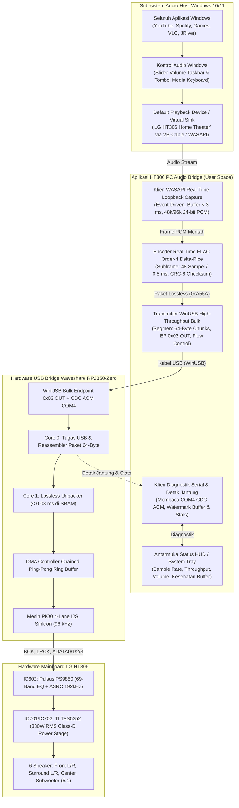

# PRD & Arsitektur Teknis: Aplikasi Jembatan Audio PC (HT306 PC Audio Bridge Companion)

<p align="center">
  <b>Bahasa Indonesia</b> |
  <a href="05_PC_Audio_Bridge_PRD_and_Architecture.md">English</a>
</p>

---

## 1. Visi & Tujuan Produk (*Objective*)

Membangun aplikasi perantara audio berkinerja tinggi dan ultra-ringan di PC (**`HT306 Audio Bridge`**) untuk Windows 10/11 yang menjembatani audio sistem desktop (YouTube, Spotify, Game, Netflix) serta aplikasi pemutar musik audiophile (JRiver, Foobar2000, Tidal) menuju **LG HT306 Home Theater** melalui mikrokontroler **Waveshare RP2350-Zero** via pipa **WinUSB Bulk**.

### Masalah Utama yang Dipecahkan Secara Tuntas
Implementasi native USB Audio Class 2.0 (UAC2) pada USB Full-Speed (12 Mbps) menyebabkan latensi DPC kernel tinggi, stutter/freeze parah pada seluruh UI Windows, serta matinya layanan audio Windows akibat bug batas waktu (timeout) pada driver `usbaudio2.sys`. **HT306 PC Audio Bridge** menuntaskan masalah ini secara permanen:
- **Zero Kernel Hang:** Berkomunikasi murni via driver standar Microsoft `WinUSB` (`winusb.sys`) di *user-space* tanpa menyentuh kernel audio.
- **Pengalaman Audio Windows Alami:** Windows mendeteksi perangkat pemutar audio resmi (*"Speakers (LG HT306 Home Theater)"* via Virtual Audio Device / WASAPI Loopback). Pengguna dapat mengatur volume melalui slider taskbar Windows, tombol keyboard volume/mute, dan mixer volume per-aplikasi.
- **100% Bit-Perfect 96 kHz 5.1 Surround:** Menggunakan kompresi lossless real-time Delta-Rice (~716 KB/s vs 1.728 KB/s mentah) dengan jaminan kontrol aliran hardware ACK/NAK dan latensi sangat rendah (`< 5 ms`).

---

## 2. Arsitektur Sistem & Alur Data End-to-End



---

## 3. Spesifikasi Fungsional (FR)

### FR-01: Mesin Penangkapan Audio Windows (WASAPI Engine)
* **Mode yang Didukung:**
  1. **Mode Virtual Device Sink (Rekomendasi Utama):** Menangkap stream dari perangkat virtual (misal driver VB-CABLE resmi WHQL) yang disetel sebagai default playback. Mengisolasi suara HT306 agar tidak keluar di speaker internal laptop/monitor.
  2. **Mode System Loopback (Instan/Zero-Install):** Menangkap audio langsung dari render endpoint default aktif menggunakan flag `AUDCLNT_STREAMFLAGS_LOOPBACK`.
* **Karakteristik Latensi:** Menggunakan penanganan *event-driven* dengan durasi buffer antara `3 ms` hingga `10 ms`.
* **Format yang Diterima:** Menerima 48.000 Hz dan 96.000 Hz, 16-bit, 24-bit, serta 32-bit float PCM; dinormalisasi secara otomatis menjadi 24-bit signed integer untuk encoder.

### FR-02: Deteksi Otomatis Perangkat & Transport WinUSB Bulk
* **Identitas Hardware Target:** `VID: 0x2E8A`, `PID: 0x4306`.
* **Antarmuka USB:** Interface 2 (Vendor Class), Endpoint `0x03` OUT (Bulk Transfer).
* **Siklus Hidup Koneksi:**
  - Mendeteksi secara otomatis saat kabel USB RP2350 dipasang atau dicabut.
  - Membuka kembali pipa USB secara otomatis tanpa crash jika kabel sempat terputus.
  - Menggunakan I/O asinkron non-blocking dengan buffer sirkular.

### FR-03: Kompresi Lossless Delta-Rice Real-Time
* **Ukuran Frame:** 48 sampel per channel per sub-frame (`0,5 ms` pada 96 kHz, `1,0 ms` pada 48 kHz).
* **Format Paket (`HT306_LosslessHeader_t` — 14 Byte):**
  ```
  [Sync Word: 0xA55A (2B)] [Packet Len (2B)] [Seq (1B)] [Flags (1B)] [NumFrames (1B)]
  [Rice K: 6B] [Payload CRC-8: 1B] [Anchor Samples: 18B] [Bitstream Residuals: ~300-450B]
  ```
* **Jaminan Bandwidth:** Throughput selalu berada di bawah `850 KB/s` bahkan pada adegan musik orkestra atau ledakan film kompleks (sangat aman di bawah batas fisik USB Full-Speed `1.023 KB/s`).

### FR-04: Integritas Bit-Perfect & Kontrol Volume
* **Pass-Through Audiophile:** Pada mode Bit-Perfect, sampel diteruskan murni tanpa perubahan, membiarkan EQ bawaan LG HT306 dan volume hardware Pulsus PS9850 mengatur dinamika suara.
* **Tracking Slider OS:** Pada mode desktop harian, volume sistem Windows dapat mengendalikan gain secara presisi menggunakan kalkulasi fixed-point Q16.

### FR-05: Diagnostik Real-Time & Monitor Serial HUD
* Terhubung secara simultan ke port serial CDC ACM (`COM4`) untuk memantau status hardware RP2350:
  - Detak jantung dan uptime mikrokontroler.
  - Persentase watermark ring buffer DMA dan catatan underrun/overrun.
  - Konfirmasi sample rate aktif (48 kHz vs 96 kHz).

---

## 4. Tech Stack & Struktur Direktori

### Tech Stack
* **Bahasa & Runtime:** Python 3.10+ (CLI/GUI Utama) dengan inti pelengkap C++20 (`pc_streamer`).
* **Audio Capture:** Native Windows WASAPI via `ctypes` (memanggil antarmuka COM `ole32.dll` / `mmdeviceapi.h`) atau `soundcard`.
* **Komunikasi USB:** Memanggil langsung `winusb.dll` dan `setupapi.dll` bawaan Windows (**100% native tanpa perlu install Zadig atau driver libusb pihak ketiga**).
* **Build Executable:** Single-file standalone `.exe` via PyInstaller (pengguna akhir tidak perlu menginstall Python).

### Tata Letak Direktori Proyek
```text
pc_streamer/
├── CMakeLists.txt                 # Konfigurasi build C++ native
├── src/
│   ├── main.c                     # Pengujian harness C streamer
│   └── (implementasi C++)
├── ht306_bridge/                  # Aplikasi Companion Python
│   ├── __init__.py
│   ├── app.py                     # Entry point utama aplikasi (CLI/GUI)
│   ├── audio_capture.py           # Klien penangkap audio WASAPI Loopback / Virtual Sink
│   ├── lossless_encoder.py        # Encoder Delta-Rice real-time 96 kHz 24-bit
│   ├── winusb_transport.py        # Wrapper native winusb.dll untuk endpoint Bulk RP2350
│   ├── cdc_monitor.py             # Pembaca diagnostik serial COM4
│   └── ui_tray.py                 # Icon status System Tray & HUD
├── run_bridge.bat                 # Script peluncur satu-klik
└── tests/
    └── test_bridge_loopback.py    # Uji otomatis pipeline loopback audio
```

---

## 5. Perintah Eksekusi (*Commands*)

```powershell
# 1. Jalankan Aplikasi Bridge pada mode development
python pc_streamer/ht306_bridge/app.py

# 2. Jalankan dengan target device tertentu (misal Virtual Cable)
python pc_streamer/ht306_bridge/app.py --device "CABLE Output" --rate 96000

# 3. Uji Verifikasi End-to-End Encoding & Pipa USB
python tests/verify_end_to_end.py

# 4. Bangun file Executable mandiri Windows (ht306_bridge.exe)
pyinstaller --onefile --name "HT306_Audio_Bridge" pc_streamer/ht306_bridge/app.py
```

---

## 6. Standar Gaya Kode (*Code Style*)

- **Clean Code:** Fungsi kecil yang melakukan satu hal pada satu tingkat abstraksi. Penamaan kata kerja untuk operasi, kata benda untuk objek status.
- **Prinsip Ponytail:** Mengutamakan DLL bawaan sistem operasi Windows (`winusb.dll`, `ole32.dll`) sebelum menambah dependensi library berat pihak ketiga.
- **Type Annotations:** Memberikan type hint lengkap pada seluruh fungsi publik.

---

## 7. Batasan Kerja (*Boundaries*)

| Kategori | Aturan |
| :--- | :--- |
| **Selalu Lakukan** | Verifikasi checksum CRC-8 pada setiap paket; reset buffer saat sample rate berganti; tangani pencabutan kabel USB secara anggun; catat jumlah frame drop. |
| **Tanyakan Dulu** | Menambah framework audio berat eksternal (seperti PortAudio / JUCE); mengubah sync word (`0xA55A`); mengubah urutan pemetaan channel. |
| **Jangan Lakukan** | Jangan menggunakan kompresi lossy (seperti MP3/AAC); jangan melakukan upmixing/audio mixing palsu; jangan menginstall driver kernel unsigned. |

---

## 8. Kriteria Keberhasilan (*Success Criteria*)

1. **Zero PC Lag:** Menjalankan aplikasi bridge menghasilkan 0% stuttering UI Windows, nol lonjakan latensi DPC, dan 0 frame drop selama 2 jam pemutaran kontinyu.
2. **Kemurnian Suara (Bit-Perfect):** Terverifikasi secara matematis dengan 0 bit error.
3. **Latensi Sangat Rendah:** Delay transmisi audio end-to-end di bawah `10 ms` (bebas delay lip-sync saat menonton video/film).
4. **Efisiensi Bandwidth:** Throughput USB selalu berada di bawah `850 KB/s`.
5. **Integrasi Windows:** Slider volume taskbar dan tombol mute Windows mengontrol suara secara alami.
