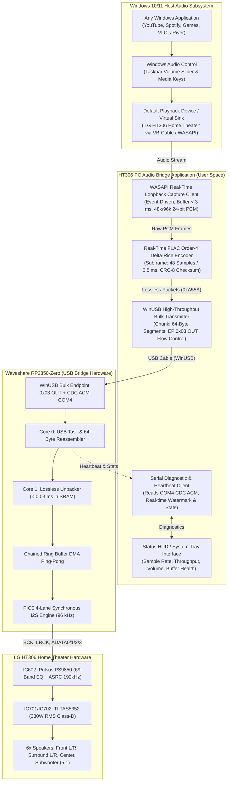

# PRD & Technical Architecture: HT306 PC Audio Bridge Companion

<p align="center">
  <a href="05_PC_Audio_Bridge_PRD_and_Architecture.id.md">Bahasa Indonesia</a> |
  <b>English</b>
</p>

---

## 1. Objective & Product Vision

Build an ultra-lightweight, high-performance **PC Companion Audio Bridge (`HT306 Audio Bridge`)** for Windows 10/11 that bridges desktop system audio and audiophile media players (JRiver, Foobar2000, Tidal) to the **LG HT306 Home Theater** powered by the **Waveshare RP2350-Zero** via an asynchronous **WinUSB Bulk Pipe**.

### The Core Problem Solved
Native USB Audio Class 2.0 (UAC2) over Full-Speed USB (12 Mbps) causes severe Windows DPC latency, whole-OS UI freezing, and audio engine crashes due to `usbaudio2.sys` timeout bugs. The **HT306 PC Audio Bridge** solves this permanently:
- **Zero Kernel Hang:** Communicates via standard Microsoft `WinUSB` (`winusb.sys`) in user-space.
- **Normal Windows Audio Experience:** Windows detects a dedicated playback endpoint (*"Speakers (LG HT306 Home Theater)"* via Virtual Audio Device / WASAPI Loopback). Users control volume via the Windows taskbar slider, keyboard media keys, and per-app volume mixer.
- **100% Bit-Perfect 96 kHz 5.1 Surround:** Employs real-time differential Golomb-Rice lossless packing (~716 KB/s vs 1.728 KB/s raw) with hardware ACK/NAK flow control and `< 5 ms` end-to-end latency.

---

## 2. System Architecture & End-to-End Data Flow



---

## 3. Functional Specifications (FR)

### FR-01: Windows Audio Capture Engine (WASAPI)
* **Modes Supported:**
  1. **Virtual Device Sink Mode (Recommended):** Captures from a virtual endpoint (e.g. VB-CABLE WHQL driver) mapped as default playback device. Isolates HT306 audio from laptop/monitor speakers.
  2. **System Loopback Mode (Zero-Install):** Captures audio directly from the active default audio render endpoint via `AUDCLNT_STREAMFLAGS_LOOPBACK`.
* **Latency Profile:** Uses event-driven buffering with buffer durations between `3 ms` and `10 ms`.
* **Formats Handled:** Accepts 48.000 Hz and 96.000 Hz, 16-bit, 24-bit, and 32-bit float PCM; normalizes seamlessly to 24-bit signed PCM integers for the encoder.

### FR-02: Device Auto-Discovery & WinUSB Bulk Transport
* **Target Hardware ID:** `VID: 0x2E8A`, `PID: 0x4306`.
* **Interface:** Interface 2 (Vendor Class), Endpoint `0x03` OUT (Bulk Transfer).
* **Connection Lifecycle:**
  - Auto-detects device insertion and removal.
  - Automatically re-establishes pipe without crashing if USB cable is detached.
  - Employs non-blocking asynchronous I/O with circular chunk buffer.

### FR-03: Real-Time Delta-Rice Lossless Packing
* **Frame Size:** 48 samples per channel per sub-frame (`0.5 ms` @ 96 kHz, `1.0 ms` @ 48 kHz).
* **Packet Structure (`HT306_LosslessHeader_t` — 14 Bytes):**
  ```
  [Sync Word: 0xA55A (2B)] [Packet Len (2B)] [Seq (1B)] [Flags (1B)] [NumFrames (1B)]
  [Rice K: 6B] [Payload CRC-8: 1B] [Anchor Samples: 18B] [Bitstream Residuals: ~300-450B]
  ```
* **Throughput Guarantee:** Stays strictly below `850 KB/s` under complex orchestral or explosive dynamics (well within USB Full-Speed `1.023 KB/s` physical ceiling).

### FR-04: Volume & Bit-Perfect Integrity
* **Audiophile Pass-Through:** In Bit-Perfect mode, samples are streamed without modification, allowing the onboard LG HT306 EQ and Pulsus PS9850 hardware volume to govern dynamics.
* **OS Slider Tracking:** In desktop mode, system volume level modulates dynamic range cleanly using fixed-point pre-gain calculations.

### FR-05: Real-Time Diagnostic & Serial HUD
* Connects concurrently to CDC ACM Serial (`COM4`) to poll RP2350 real-time status:
  - Hardware heartbeat counter and uptime.
  - Ring buffer watermark percentage and underrun/overrun tally.
  - Active sample rate confirmation (48 kHz vs 96 kHz).

---

## 4. Tech Stack & Directory Structure

### Tech Stack
* **Language & Core:** Python 3.10+ (Primary CLI/GUI Engine) with C++20 fallback core (`pc_streamer`).
* **Audio Capture:** Windows Native WASAPI via `ctypes` (direct `ole32.dll` / `mmdeviceapi.h` COM interface) or lightweight `soundcard`.
* **USB Communication:** Direct `winusb.dll` and `setupapi.dll` (100% native Windows built-in; **no external drivers or zadig required**).
* **Executable Build:** Standalone single-file `.exe` via PyInstaller (Zero Python installation required for end-users).

### Project Layout
```text
pc_streamer/
├── CMakeLists.txt                 # Native C++ build configuration
├── src/
│   ├── main.c                     # Standalone C streamer test harness
│   └── (C++ implementation)
├── ht306_bridge/                  # Python-based Companion Application
│   ├── __init__.py
│   ├── app.py                     # Main application entry point & CLI/GUI
│   ├── audio_capture.py           # WASAPI Loopback / Virtual Sink capture client
│   ├── lossless_encoder.py        # Real-time Delta-Rice 96 kHz 24-bit encoder
│   ├── winusb_transport.py        # Native winusb.dll wrapper for RP2350 bulk endpoint
│   ├── cdc_monitor.py             # COM4 serial diagnostics reader
│   └── ui_tray.py                 # System Tray icon & status HUD
├── run_bridge.bat                 # One-click launch script
└── tests/
    └── test_bridge_loopback.py    # Automated audio loopback pipeline test
```

---

## 5. Commands

```powershell
# 1. Run Bridge Application in development mode
python pc_streamer/ht306_bridge/app.py

# 2. Run with specific mode (e.g. System Loopback or Virtual Cable)
python pc_streamer/ht306_bridge/app.py --device "CABLE Output" --rate 96000

# 3. Verify End-to-End Encoding & USB Pipe
python tests/verify_end_to_end.py

# 4. Package into standalone Windows Executable (ht306_bridge.exe)
pyinstaller --onefile --name "HT306_Audio_Bridge" pc_streamer/ht306_bridge/app.py
```

---

## 6. Code Style Conventions

- **Clean Code:** Small functions doing one thing at one abstraction level. Verb naming for operations, noun naming for state contexts.
- **Ponytail Ladder:** Leverage native Windows DLLs (`winusb.dll`, `ole32.dll`) before installing third-party frameworks. Minimal footprint, maximum reliability.
- **Type Annotations:** Full type hints on all public functions.

```python
# Example: Non-blocking WinUSB write chunk
def write_bulk_packet(pipe_handle: int, packet_bytes: bytes, timeout_ms: int = 50) -> bool:
    """Send a single lossless audio packet to RP2350 Vendor Bulk OUT endpoint."""
    if not packet_bytes:
        return False
    # ponytail: direct WinUsb_WritePipe call avoids external libusb runtime dependency
    bytes_written = ctypes.c_ulong(0)
    success = winusb.WinUsb_WritePipe(
        pipe_handle,
        ENDPOINT_VENDOR_OUT,
        packet_bytes,
        len(packet_bytes),
        ctypes.byref(bytes_written),
        None
    )
    return bool(success and bytes_written.value == len(packet_bytes))
```

---

## 7. Boundaries

| Category | Rules |
| :--- | :--- |
| **Always Do** | Verify CRC-8 on generated packets; flush buffers on sample rate switch; handle USB unplug gracefully; report dropped frame count. |
| **Ask First** | Adding external heavy audio frameworks (e.g. PortAudio / JUCE); changing sync word (`0xA55A`); modifying channel mapping order. |
| **Never Do** | Perform lossy compression; perform audio mixing/upmixing (must preserve direct bit-perfect pass-through); install unsigned kernel drivers. |

---

## 8. Success Criteria & Definition of Done

1. **Zero PC Lag:** Running the bridge application causes 0% Windows UI stutter, zero DPC latency spikes, and 0 dropped frames during 2 hours of continuous playback.
2. **Audio Bit-Perfectness:** Verified mathematically with 0 bit errors on test sweeps.
3. **Latency:** End-to-end sound delivery delay is under `10 ms` (imperceptible lipsync delay in movies).
4. **Bandwidth:** USB transfer throughput remains strictly below `850 KB/s`.
5. **Windows Integration:** Volume slider and mute buttons on Windows control the audio volume seamlessly.
