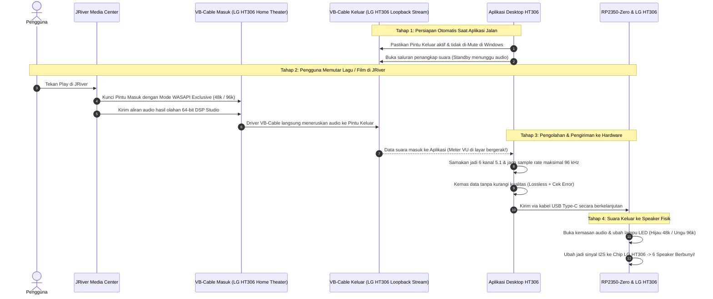
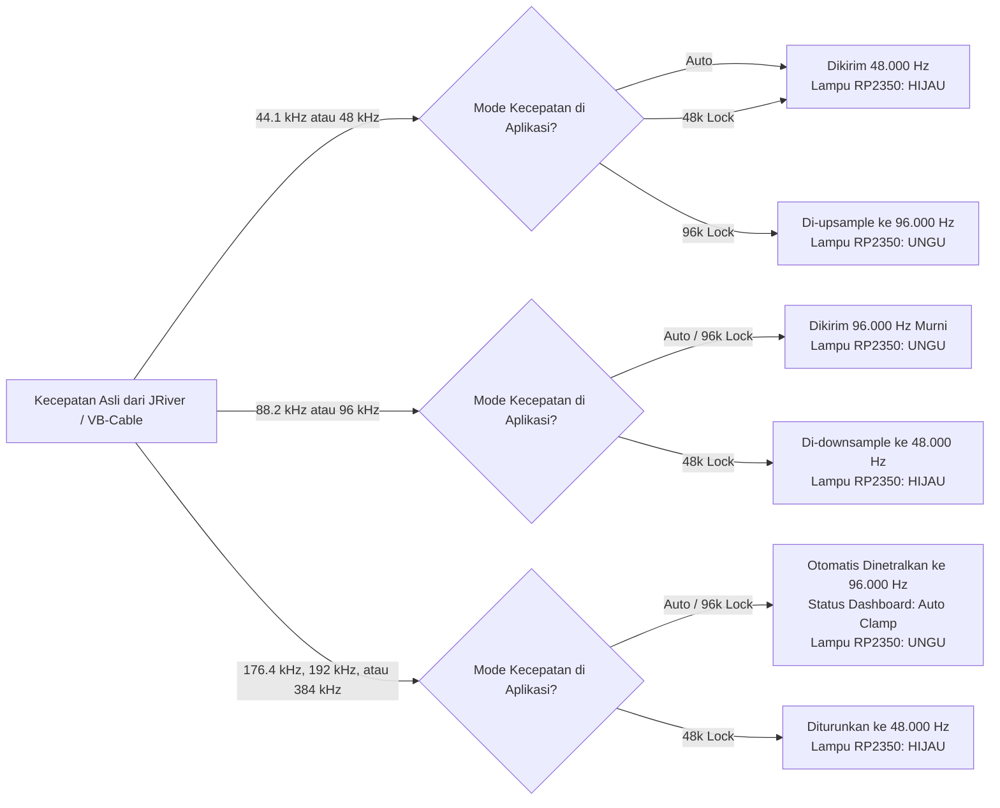

# 6. Topologi & Alur Data Audio Khusus JRiver Media Center

🌐 **Bahasa:** [English](./06_JRiver_Audio_Data_Topology.md) | **Bahasa Indonesia**

[⬅️ Kembali ke README Utama](../README.id.md) | [Panduan Setup JRiver](./04_Build_Flash_and_JRiver_Setup.id.md) | [PRD & Arsitektur PC Bridge](./05_PC_Audio_Bridge_PRD_and_Architecture.id.md) | [Topologi Sistem Utuh](./07_Complete_Architecture_and_Topology.id.md) | [Kredit & Stack Teknologi](./08_Credits_and_Acknowledgments.id.md)

Dokumen ini menjelaskan secara sederhana dan menyeluruh bagaimana suara dari **JRiver Media Center** berjalan melewati **VB-Cable**, ditangkap oleh **Aplikasi Desktop HT306**, lalu dikirim lewat kabel USB ke **Waveshare RP2350-Zero** hingga akhirnya berbunyi di ke-6 speaker **Home Theater LG HT306**.

Penjelasan disusun agar mudah dipahami oleh pengguna umum di luar pemrograman sekalipun, disertai catatan teknis di bagian akhir mengenai file kode mana saja yang menjalankan setiap tugas tersebut.

---

## 6.1. Gambaran Sederhana dalam Satu Kalimat

Secara sederhana, alur suara yang terjadi di komputer Anda adalah:

> **JRiver** memutar musik/film ke **VB-Cable** (*kartu suara virtual*) → **Aplikasi Desktop HT306** langsung mengambil suara dari VB-Cable dan menyesuaikan formatnya → **Aplikasi** mengirimkannya lewat kabel USB ke **RP2350-Zero** → **RP2350-Zero** membunyikan suara ke **6 speaker LG HT306**.

### Mengapa Tidak Langsung dari JRiver ke RP2350?
* **RP2350-Zero** pada sistem ini berkomunikasi memakai jalur data USB khusus berkecepatan stabil (*WinUSB Bulk*) dan **tidak** menyamar sebagai kartu suara standar Windows (*USB Audio Class 2*), karena driver bawaan kartu suara USB Windows terbukti memicu *lag* dan macet (*freeze*) pada komputer saat berjalan di USB Full-Speed.
* Agar JRiver tetap melihat sebuah "speaker/kartu suara" untuk memutar lagu, digunakan **VB-Cable** sebagai **kartu suara virtual** perantara di dalam Windows.
* **Aplikasi Desktop HT306** berperan sebagai **kurir pengambil dan pengepak** yang mengambil audio dari kartu suara virtual tersebut lalu mengantarkannya secara *real-time* ke papan RP2350-Zero.

---

## 6.2. Diagram Topologi Alur Data Audio JRiver

Diagram berikut memperlihatkan seluruh perjalanan suara dari atas ke bawah hingga keluar di speaker rumah:

```mermaid
flowchart TB
    subgraph S1["1. JRiver Media Center (Pemutar Musik & Film)"]
        direction TB
        JR_FILE["File Sumber Audio / Video\nStereo 2.0 atau Surround 5.1\nFLAC, WAV, MKV, MP3, Hi-Res"]
        JR_DSP["Mesin Hitung 64-Bit & DSP Studio\nAtur Equalizer, Volume, & Jarak Speaker\nPresisi super halus agar suara tidak pecah"]
        JR_OUT["Keluaran WASAPI JRiver\nTarget: 'LG HT306 Home Theater'\nMendukung Mode Eksklusif atau Shared"]

        JR_FILE --> JR_DSP --> JR_OUT
    end

    subgraph S2["2. VB-Cable (Kartu Suara Virtual 'Dua Pintu')"]
        direction TB
        VBC_IN["Pintu Masuk / Pemutaran - Playback\nNama di Windows: 'LG HT306 Home Theater'\nBoleh dikunci Eksklusif oleh JRiver"]
        VBC_PIPE["Driver Internal Windows - VB-Cable\nMenyalin aliran suara secara instan\ndari Pintu Masuk ke Pintu Keluar"]
        VBC_OUT["Pintu Keluar / Rekaman - Recording\nNama di Windows: 'LG HT306 Loopback Stream'\nOtomatis diaktifkan oleh Aplikasi"]

        VBC_IN -->|"Masuk ke Driver Virtual"| VBC_PIPE -->|"Muncul di Sisi Rekaman"| VBC_OUT
    end

    subgraph S3["3. Aplikasi Desktop HT306 (Kurir & Pengolah Suara)"]
        direction TB
        APP_POLICY["Penjaga Koneksi Windows\nOtomatis aktifkan 'LG HT306 Loopback Stream'\n& pindah default speaker saat RP2350 dicolok"]
        APP_CAP["Mesin Penangkap Suara - Capture\nAmbil audio lewat Pintu Keluar VB-Cable\nAman tanpa bentrok dengan gembok Eksklusif JRiver"]
        APP_DSP["Penyesuai Format, Kanal & Kecepatan\n1. Samakan jadi 6 Kanal 5.1\n2. Jaga Sample Rate aman 48 kHz atau 96 kHz\n3. Atur Volume, Limiter & Meter VU Layar"]
        APP_PACK["Pengepak Data Lossless - Tanpa Mengurangi Kualitas\nKemas tiap 48 sampel + pengaman CRC-8\nUkuran mengecil agar lancar lewat kabel USB"]
        APP_USB["Pengirim USB - WinUSB Bulk\nKirim paket lewat jalur Endpoint 0x03 OUT"]

        APP_POLICY -.->|"Aktifkan & Unmute"| VBC_OUT
        APP_CAP --> APP_DSP --> APP_PACK --> APP_USB
    end

    subgraph S4["4. Waveshare RP2350-Zero & Amplifier LG HT306"]
        direction TB
        RP_RX["Chip Inti 0 - Penerima USB\nMenangkap paket data USB & menyusun ulang\nMenyalakan lampu LED status di papan"]
        RP_DEC["Chip Inti 1 - Pembuka Kemasan Audio\nMengembalikan data ke PCM 32-bit 6 Kanal utuh\nOtomatis ikut kecepatan 48 kHz atau 96 kHz"]
        RP_I2S["Mesin I2S PIO0 & DMA Ping-Pong\nMengubah data menjadi detak sinyal digital fisik\nPin GP2..GP6: Clock & 3 Jalur Data Audio"]
        LG_AMP["Mainboard LG HT306 - Mode AUX\nChip Pulsus PS9850 + Power Amp TAS5352\nEQ Bawaan & Remote LG tetap berfungsi penuh"]
        SPK["6 Speaker Fisik Surround 5.1\nFront L/R, Center, Subwoofer LFE, Surround L/R"]

        RP_RX --> RP_DEC --> RP_I2S --> LG_AMP --> SPK
    end

    JR_OUT ==>|"Suara Masuk\n(Boleh Mode Exclusive)"| VBC_IN
    VBC_OUT ==>|"Suara Diambil Aplikasi\n(Tanpa Tabrakan Kunci)"| APP_CAP
    APP_USB ==>|"Kabel USB Type-C\nData Lossless (Sync 0xA55A)"| RP_RX
```

---

## 6.3. Bagaimana JRiver "Mode Eksklusif" Bisa Jalan Tanpa Membuat Suara Hilang?

Banyak pengguna mengalami suara macet atau indikator meter di aplikasi tidak bergerak ketika mengaktifkan **WASAPI Exclusive** di JRiver. Agar mudah dipahami, bayangkan **VB-Cable seperti sebuah terowongan yang punya dua pintu berbeda**:

1. **Pintu Masuk (*Playback / `LG HT306 Home Theater`*)**: Tempat JRiver mendorong suara masuk.
2. **Pintu Keluar (*Recording / `LG HT306 Loopback Stream`*)**: Tempat suara tersebut muncul kembali untuk diambil oleh Aplikasi Desktop.

* **Masalah yang terjadi sebelumnya:**
  Mode **WASAPI Exclusive** pada JRiver bersifat seperti "memasang gembok VIP" pada **Pintu Masuk** agar tidak ada aplikasi Windows lain yang ikut mencampuri suara di pintu tersebut. Sebelum pembaruan arsitektur, Aplikasi Desktop juga mencoba mengintip lewat **Pintu Masuk yang sama** (*Loopback Playback*). Akibatnya Windows menolak akses aplikasi, sehingga data suara tidak masuk ke aplikasi maupun ke RP2350. Selain itu, Windows sering mematikan **Pintu Keluar** secara bawaan.
* **Cara kerjanya sekarang:**
  Aplikasi Desktop kini secara otomatis menyalakan **Pintu Keluar (`LG HT306 Loopback Stream`)** lalu mengambil suara dari pintu belakang tersebut. Sementara itu, JRiver bebas mengunci **Pintu Masuk** secara penuh (*Exclusive*) sepuasnya tanpa pernah bertabrakan dengan Aplikasi Desktop.

Berikut diagram urutan langkah demi langkah dari mulai aplikasi dibuka hingga speaker berbunyi:

---

## 6.4. Penjelasan Pengolahan Angka "64-Bit" & Penyesuaian Sample Rate Otomatis

### Apa Maksud "64-Bit" di JRiver? Apakah Aman?
* Saat Anda melihat keterangan **64-bit** di JRiver (*64-bit audio engine / DSP Studio*), itu berarti **ketelitian hitungan matematika di dalam JRiver** saat mengatur *Equalizer*, volume digital, atau *upsampling*. Tujuannya agar detail suara halus tidak hilang selama proses hitung internal.
* Saat suara meninggalkan JRiver menuju Windows dan VB-Cable, komputer secara otomatis menurunkannya ke format kontainer **24-bit atau 32-bit PCM**, yang kemudian ditangkap oleh Aplikasi Desktop dan diteruskan utuh ke chip **Pulsus PS9850** di LG HT306. Jadi, menggunakan engine 64-bit di JRiver **100% aman dan justru bagus untuk kejernihan**.

### Apa yang Terjadi Jika Sample Rate di JRiver Diubah-ubah?
Chip suara pada **RP2350-Zero** dan **LG HT306** berjalan paling stabil pada standar **`48 kHz`** (standar film/TV) atau **`96 kHz`** (standar Hi-Res Audio). Diagram di bawah menjelaskan bagaimana Aplikasi Desktop menjaga kecepatan suara JRiver agar selalu aman:

* **Jika kecepatan asli sudah sama dengan target** (misalnya JRiver mengeluarkan `48 kHz` dan targetnya `48 kHz`, atau JRiver `96 kHz` dan targetnya `96 kHz`), pengubah kecepatan (*resampler*) akan masuk mode **Bypass** (dilewati langsung tanpa mengubah satu bit pun).
* **Jika JRiver diatur lebih tinggi dari `96 kHz`** (misalnya `192 kHz`), pada mode **Auto** aplikasi akan otomatis menetralkannya ke **`96 kHz`** memakai filter berkualitas tinggi (*Windowed-Sinc*) agar RP2350-Zero tetap berbunyi mulus tanpa suara putus-putus atau error.
* **Jika musik berhenti / hening total selama sekitar 0,6 detik**, aplikasi berhenti mengirim paket audio agar papan RP2350-Zero kembali ke mode **Standby (LED Biru)** secara bersih.

---

## 6.5. Panduan Singkat untuk Pengguna Non-Teknis

Agar koneksi JRiver selalu lancar setiap kali digunakan:
1. **Di JRiver Media Center:** Pilih perangkat output **`LG HT306 Home Theater [WASAPI]`**. Jangan menyalakan fitur *Bitstreaming* mentah (Dolby/DTS terkompresi langsung tanpa di-decode), karena aplikasi ini menerima audio PCM/Float yang sudah dipecah menjadi 2 hingga 6 kanal.
2. **Di Windows Privacy Settings (*Izin Mikrofon*):** Pastikan izin akses **Mikrofon untuk aplikasi desktop (*Allow desktop apps to access your microphone*)** dalam keadaan **ON**. Karena Pintu Keluar VB-Cable (`LG HT306 Loopback Stream`) dikategorikan Windows sebagai perangkat rekaman/mikrofon, jika izin ini mati Windows akan memblokir aplikasi mengambil suara dari JRiver.
3. **Di LG HT306:** Pastikan unit Home Theater menyala pada mode **`AUX`**. Anda tetap bebas memilih preset EQ bawaan LG (`BASS BLAST`, `NATURAL`, `PLII MOVIE`, dll.) melalui remote asli LG.
4. **Cek Warna Lampu LED di Papan RP2350-Zero:**
   * 🔵 **Biru:** Siaga (*Standby*) — RP2350 terhubung, menunggu musik diputar atau sedang jeda.
   * 🟢 **Hijau:** Musik/film sedang berjalan di **`48 kHz`** (`5.1 Surround`).
   * 🟣 **Ungu:** Musik/film sedang berjalan di **`96 kHz`** (`5.1 Hi-Res Lossless`).
   * 🔴 **Merah:** Ada gangguan data / kerusakan paket / kesalahan inisialisasi I2S.

---

## 6.6. Catatan Teknis: Daftar File Kode Sumber yang Bertugas

Bagian ini mencatat file-file kode sumber aktual di dalam repositori beserta tanggung jawab spesifik masing-masing pada topologi di atas.

### A. Aplikasi Desktop Host (`pc_stream_app/`)

| Tahapan pada Topologi | File yang Bertugas | Fungsi / Tugas Utama di Dalam Kode |
| :--- | :--- | :--- |
| **Penjaga Pintu Masuk & Pintu Keluar VB-Cable** | [audio_policy_manager.h](../pc_stream_app/src/audio_policy_manager.h) [audio_policy_manager.cpp](../pc_stream_app/src/audio_policy_manager.cpp) [policy_config.h](../pc_stream_app/src/policy_config.h) | • `SyncEndpointNames()`: Menamai endpoint menjadi `LG HT306 Home Theater` dan `LG HT306 Loopback Stream`, serta menyembunyikan varian 16-kanal. • `EnsureCaptureEndpointActive()`: Memaksa endpoint rekaman `eCapture` (`LG HT306 Loopback Stream`) aktif (`DEVICE_STATE_ACTIVE`) melalui Registry & COM `IPolicyConfig`. • `SwitchToHT306()` & `RestorePreviousDefault()`: Mengalihkan audio default Windows secara otomatis saat RP2350 terhubung/terputus. • `ApplySampleRateToHT306Endpoints()`: Mengatur format 5.1 surround `48000` atau `96000 Hz` pada endpoint Render dan Capture. |
| **Penangkap Audio dari VB-Cable & Pengirim Paket** | [audio_capture.h](../pc_stream_app/src/audio_capture.h) [audio_capture.cpp](../pc_stream_app/src/audio_capture.cpp) | • `CaptureLoop()`: Membuka `eCapture` (`LG HT306 Loopback Stream`) sebagai jalur utama agar tidak bentrok dengan *WASAPI Exclusive* JRiver (dengan cadangan *eRender Loopback*). • `CheckCaptureEndpointGain()`: Membuka *mute* secara otomatis jika pin rekaman sempat ter-mute di Windows. • `NormalizeChannelsTo6Ch()`: Menyeragamkan suara mono, stereo, atau 5.1 menjadi 6 kanal (`FL, FR, C, LFE, SL, SR`). • `EmitProcessedFrames6Ch()`: Mengatur gain, solo/mute, soft limiter `tanh()`, perhitungan meter VU, *silence gate* (~600 ms), mengemas 48 sampel ke encoder lossless, serta melakukan *micro-pacing* burst agar buffer RP2350 tidak meluap. |
| **Pengubah Format, Sample Rate & Resampler DSP** | [audio_rate_dsp.h](../pc_stream_app/src/audio_rate_dsp.h) | • `ResolveTargetSampleRate()`: Menjaga target frekuensi tetap aman di `48 kHz` atau `96 kHz` (`AUTO` menetralkan input `> 96 kHz` menjadi `96 kHz`). • `DecodeInterleavedFrameToFloat6()`: Membaca format `IEEE_FLOAT32`, `PCM16`, `PCM24_PACKED`, maupun `PCM32` menjadi `float` standar. • `RateResampler6Ch`: Resampler 6-kanal memakai *Blackman Windowed-Sinc* (`16`–`64` tap), dan langsung *bypass bit-exact* bila frekuensi asal sudah sama dengan target. • `FloatToInt32Safe()`: Konversi aman `float` → `int32_t` presisi ganda tanpa risiko *overflow*. |
| **Komunikasi USB & Monitor Serial** | [usb_transport.h](../pc_stream_app/src/usb_transport.h) [usb_transport.cpp](../pc_stream_app/src/usb_transport.cpp) | • `CheckHardwarePresence()` & `Open()`: Mendeteksi perangkat RP2350 (`VID 0x2E8A`, `PID 0x4306`) dan membuka pipa **WinUSB Bulk OUT (`EP 0x03`)**. • `WritePacket()`: Mengirim paket audio terkompresi via `WinUsb_WritePipe`. • `WorkerLoop()`, `OpenSerialPort()`, & `PollSerial()`: Mengelola *hotplug* USB dan membaca pesan *heartbeat* / log dari port serial CDC (`COMx`). |
| **Daftar Perangkat & Penyimpan Status Bersama** | [audio_endpoint_helper.h](../pc_stream_app/src/audio_endpoint_helper.h) [audio_endpoint_helper.cpp](../pc_stream_app/src/audio_endpoint_helper.cpp) [app_state.h](../pc_stream_app/src/app_state.h) [app_state.cpp](../pc_stream_app/src/app_state.cpp) | • `EnumerateDevices()`: Mendaftar perangkat audio aktif di Windows. • `AppState`: Menyimpan pilihan perangkat, mode sample rate (`AUTO` / `LOCK_96K` / `LOCK_48K`), telemetri atomik (`StreamTelemetry`), nilai VU meter 6 kanal (`ChannelMeters`), serta pemicu re-inisialisasi capture. |
| **Antarmuka Dashboard & Jembatan WebView2** | [main_webview.cpp](../pc_stream_app/src/main_webview.cpp) [settings.js](../pc_stream_app/ui/js/settings.js) [telemetry.js](../pc_stream_app/ui/js/telemetry.js) [CMakeLists.txt](../pc_stream_app/CMakeLists.txt) | • `PolicyWorkerLoop()` di `main_webview.cpp`: Menjalankan pergantian endpoint, perubahan sample rate, dan merespons event hotplug `WM_DEVICECHANGE`, serta mengirim JSON telemetri ke UI. • `settings.js` & `telemetry.js`: Menampilkan status rate (`Auto ≤96k`, `Auto Clamp`, `Terkunci`), jalur capture aktif, dan meter VU 6 kanal secara *real-time*. |

---

### B. Codec Lossless Bersama & Firmware Mikrokontroler (`firmware/`)

| Tahapan pada Topologi | File yang Bertugas | Fungsi / Tugas Utama di Dalam Kode |
| :--- | :--- | :--- |
| **Algoritma Kompresi & Dekompresi Lossless** | [lossless_codec.h](../firmware/include/lossless_codec.h) [lossless_codec.c](../firmware/src/lossless_codec.c) | • **Dipakai oleh PC & RP2350 secara bersamaan** (lihat `CMakeLists.txt`). • Di PC (`ht306_lossless_encode_frame_flags`): Mengemas 48 sampel × 6 kanal menjadi paket ≤ 1020 byte berheader `14 byte` (`Sync 0xA55A`, `sequence`, `flags`, `num_frames`, `rice_k[6]`, dan `payload_crc8`). • Di RP2350 (`ht306_lossless_decode_frame`): Membongkar paket kembali menjadi PCM 32-bit `0 bit error`. |
| **Penerima USB & Descriptor Windows** | [ht306_usb.h](../firmware/include/ht306_usb.h) [tusb_config.h](../firmware/include/tusb_config.h) [usb_descriptors.c](../firmware/src/usb_descriptors.c) | • Mendeklarasikan identitas USB Composite (`CDC ACM Serial` + `Vendor WinUSB Bulk EP 0x03 OUT`) dan descriptor **Microsoft OS 2.0** agar Windows otomatis mengenali WinUSB tanpa Zadig. • `ht306_usb_task()` & `ht306_usb_process_vendor_stream()`: Mengambil potongan byte dari TinyUSB dan merakitnya kembali menjadi paket `0xA55A` yang utuh. |
| **Orkestrasi Dual-Core RP2350-Zero** | [main.c](../firmware/src/main.c) | • **Core 0 (`main`):** Mengelola USB stack (`ht306_usb_task()`), memasukkan paket ke antrian *lock-free* `g_packet_queue[32]`, membangunkan Core 1 dengan sinyal `__sev()`, dan mencetak *heartbeat* + VU meter ke serial CDC. • **Core 1 (`ht306_core1_lossless_worker`):** Bangun seketika dari `__wfe()`, mendekode paket lossless di SRAM, menyetel clock I2S (`48 kHz` atau `96 kHz`), mengirim audio ke I2S, dan mengganti warna LED RGB. |
| **Mesin DMA & Pembangkit Sinyal Digital I2S** | [i2s_engine.h](../firmware/include/i2s_engine.h) [i2s_engine.c](../firmware/src/i2s_engine.c) [i2s_multi.pio](../firmware/src/i2s_multi.pio) | • Menyediakan *SPSC ring buffer* di SRAM (`g_pio_ring_buffer`), pengaman hening `g_silence_block`, serta **Chained Ping-Pong DMA** dengan koreksi drift clock halus (±0,02%). • Program assembly `i2s_multi.pio` (`PIO0_SM0`) mengirim bit audio serentak lewat pin `GP2` (`BCK`), `GP3` (`LRCK`), dan `GP4`–`GP6` (`ADATA0`–`ADATA2`) ke chip `IC602 (Pulsus PS9850)` pada mainboard LG HT306. |
| **Kontrol LED Indikator, MUX & Remote** | [ht306_control.h](../firmware/include/ht306_control.h) [ht306_control.c](../firmware/src/ht306_control.c) | • Mengatur pin MUX **`GP8`** (`HIGH` = mode PC USB aktif), pin remote **`GP9`**, serta mengendalikan LED RGB WS2812 onboard di pin **`GP16`** (Biru = Standby, Hijau = 48 kHz, Ungu = 96 kHz, Merah = Error). |
