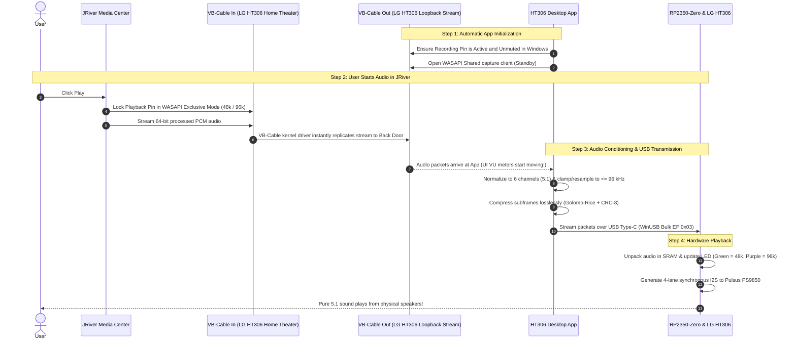
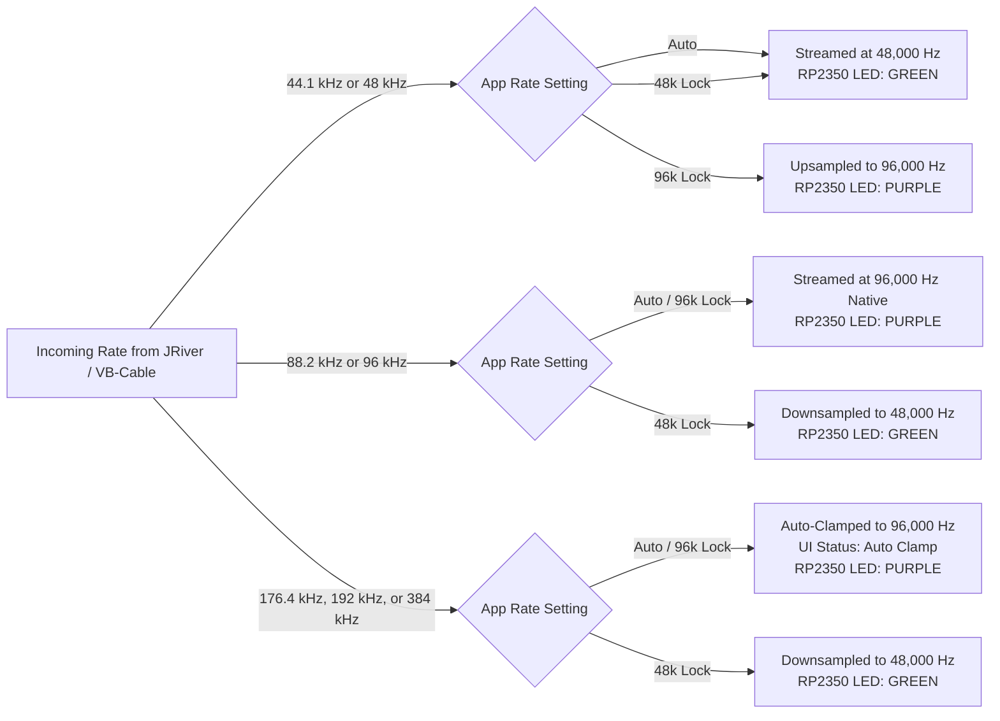

# 6. Audio Data Pipeline & Topology for JRiver Media Center

🌐 **Language:** **English** | [Bahasa Indonesia](./06_JRiver_Audio_Data_Topology.id.md)

[⬅️ Back to Main README](../README.md) | [JRiver Setup Guide](./04_Build_Flash_and_JRiver_Setup.md) | [PC Audio Bridge PRD](./05_PC_Audio_Bridge_PRD_and_Architecture.md) | [Complete System Topology](./07_Complete_Architecture_and_Topology.md) | [Credits & Tech Stack](./08_Credits_and_Acknowledgments.md)

This document provides a clear, comprehensive, and non-technical explanation of how audio generated by **JRiver Media Center** travels through **VB-Cable**, is captured and conditioned by the **HT306 Desktop Host Application**, and is streamed via USB to the **Waveshare RP2350-Zero** to drive the 6 physical speakers of the **LG HT306 Home Theater**.

The guide is written so that anyone can understand the data flow without programming experience, while also concluding with a precise technical code-mapping section for developers.

---

## 6.1. High-Level Summary in One Sentence

At a high level, the audio path inside your computer works as follows:

> **JRiver** plays music/movies to **VB-Cable** (*virtual soundcard*) → The **HT306 Desktop App** captures the audio from VB-Cable and formats it → The **Desktop App** streams it over a USB cable to the **RP2350-Zero** → The **RP2350-Zero** drives the **6 physical speakers of the LG HT306**.

### Why Not Stream Directly from JRiver to the RP2350?
* The **RP2350-Zero** in this project uses a custom high-throughput communication protocol (**WinUSB Bulk**) rather than disguising itself as a standard Windows USB Audio Class (UAC2) sound card. Standard Windows USB Audio Class drivers at USB Full-Speed are prone to kernel DPC latency spikes, audio dropouts, and whole-system freezes.
* Because Windows does not see the RP2350 directly as a standard audio playback device, **VB-Cable** acts as the **virtual soundcard** inside Windows that JRiver can target.
* The **HT306 Desktop Application** acts as the high-speed **courier and processor**: it takes the raw digital audio from that virtual device, balances channels and sample rates, compresses it losslessly, and dispatches it over USB to the microcontroller in real time.

---

## 6.2. End-to-End Audio Data Flow Diagram

The following diagram illustrates the complete audio journey from digital source files down to the living room speakers:

```mermaid
flowchart TB
    subgraph S1["1. JRiver Media Center (Player & DSP Engine)"]
        direction TB
        JR_FILE["Source Media File\nStereo 2.0 or 5.1 Surround\nFLAC, WAV, MKV, MP3, Studio Master"]
        JR_DSP["64-Bit Audio Engine & DSP Studio\nParametric EQ, Room Correction & Volume\nDouble-precision math prevents quantization loss"]
        JR_OUT["JRiver WASAPI Output\nTarget: 'LG HT306 Home Theater'\nSupports WASAPI Exclusive or Shared Mode"]

        JR_FILE --> JR_DSP --> JR_OUT
    end

    subgraph S2["2. VB-Cable (Virtual Two-Door Audio Tunnel)"]
        direction TB
        VBC_IN["Playback Pin - Front Door\nDevice Name: 'LG HT306 Home Theater'\nLocked exclusively by JRiver bit-perfect"]
        VBC_PIPE["VB-Cable Kernel Driver (WDM)\nInstantly mirrors sample buffers\nfrom Playback Pin to Recording Pin"]
        VBC_OUT["Recording Pin - Back Door\nDevice Name: 'LG HT306 Loopback Stream'\nAuto-activated by the HT306 Desktop App"]

        VBC_IN -->|"Stream In"| VBC_PIPE -->|"Mirrored Out"| VBC_OUT
    end

    subgraph S3["3. HT306 Desktop Host App (Audio Courier & DSP Engine)"]
        direction TB
        APP_POLICY["Windows Audio Policy Guard\nAuto-activates 'LG HT306 Loopback Stream'\n& switches default speaker on RP2350 hotplug"]
        APP_CAP["Audio Capture Engine\nCaptures from the Recording Pin (eCapture)\nZero collision with JRiver's Exclusive lock"]
        APP_DSP["Channel Normalizer & Resampling DSP\n1. Normalizes stereo/mono into 6 channels (5.1)\n2. Clamps / resamples safely to <= 96 kHz\n3. Trims, gain smoothing, limiter & UI VU meters"]
        APP_PACK["Lossless Real-Time Delta-Rice Encoder\nPacks 48 samples per subframe with CRC-8\nShrinks bandwidth by ~59% for USB Full-Speed"]
        APP_USB["WinUSB Bulk Streamer\nTransmits packets via Endpoint 0x03 OUT"]

        APP_POLICY -.->|"Activate & Unmute"| VBC_OUT
        APP_CAP --> APP_DSP --> APP_PACK --> APP_USB
    end

    subgraph S4["4. Waveshare RP2350-Zero & LG HT306 Amplifier"]
        direction TB
        RP_RX["Core 0: TinyUSB Receiver\nReassembles USB byte stream into packets\nUpdates status LED & CDC diagnostic monitor"]
        RP_DEC["Core 1: Lossless Unpacker (< 0.03 ms)\nReconstructs bit-exact 32-bit PCM 6-channel\nAdapts clock to 48 kHz or 96 kHz dynamically"]
        RP_I2S["PIO0 Multi-Lane I2S & Chained DMA\nGenerates physical clock and data pulses\nGP2..GP6: BCK, LRCK, ADATA0..ADATA2"]
        LG_AMP["LG HT306 Mainboard (AUX Mode)\nPulsus PS9850 Processor + TAS5352 Power Stage\nStock LG EQ presets & Remote control fully intact"]
        SPK["6 Physical Surround Speakers (5.1)\nFront L/R, Center, Subwoofer LFE, Surround L/R"]

        RP_RX --> RP_DEC --> RP_I2S --> LG_AMP --> SPK
    end

    JR_OUT ==>|"Audio Stream In\n(WASAPI Exclusive OK)"| VBC_IN
    VBC_OUT ==>|"Captured by App\n(No Exclusive Lock Clash)"| APP_CAP
    APP_USB ==>|"USB Type-C Cable\nLossless Stream (0xA55A Sync)"| RP_RX
```

---

## 6.3. Why "WASAPI Exclusive Mode" Works Without Losing Audio

Many audiophiles experience lost audio or frozen VU meters when switching JRiver to **WASAPI Exclusive Mode**. To understand why this occurred and how it was resolved, think of **VB-Cable as a tunnel with two distinct doors**:

1. **Front Door (*Playback Pin / `LG HT306 Home Theater`*)**: Where JRiver pushes audio into Windows.
2. **Back Door (*Recording Pin / `LG HT306 Loopback Stream`*)**: Where the driver duplicates the incoming audio for recording applications.

* **The Old Problem:**
  When JRiver enables **WASAPI Exclusive Mode**, it places a strict "VIP lock" on the **Front Door**, bypassing the Windows Audio Mixer (`audiodg.exe`) and rejecting all other shared streams. Previously, the desktop application tried to take audio by opening a *Shared Loopback* stream on that **same Front Door**. Windows immediately rejected the request with `AUDCLNT_E_DEVICE_INVALIDATED` (`0x88890004`), resulting in zero audio entering the app or reaching the speakers. Furthermore, Windows often disables the **Back Door** in the registry by default.
* **The Modern Solution:**
  The HT306 Desktop App now uses Windows COM interfaces (`IPolicyConfig`) to ensure the **Back Door (`LG HT306 Loopback Stream`)** is permanently active and unmuted. The app then captures audio exclusively from this back door. Meanwhile, JRiver can lock the **Front Door** in exclusive mode without any conflict.

The following sequence diagram illustrates the lifecycle:

---

## 6.4. Understanding "64-Bit" Processing & Automatic Sample Rate Clamping

### What Does "64-Bit" in JRiver Mean? Is It Safe?
* When JRiver displays **64-bit** (*64-bit audio engine / DSP Studio*), it refers solely to the **internal mathematical precision of JRiver's digital signal processing** (equalization, volume reduction, room delay calculations). This prevents rounding errors and preserves dynamic range.
* When the audio leaves JRiver toward Windows and VB-Cable, JRiver automatically formats it into a standard **24-bit or 32-bit PCM integer stream**, which our desktop app captures and passes faithfully to the **Pulsus PS9850** digital processor. Thus, using JRiver's 64-bit engine is **100% safe and highly recommended for fidelity**.

### What Happens When You Change the Sample Rate in JRiver?
The audio processing hardware on the **RP2350-Zero** and the **LG HT306** operates natively and optimally at either **`48 kHz`** (standard for films, games, and YouTube) or **`96 kHz`** (standard for Hi-Res music and TrueHD). The following flowchart illustrates how the desktop application handles different incoming sample rates:

* **When the source rate matches the target rate** (e.g., JRiver outputs `48 kHz` and target is `48 kHz`, or `96 kHz` and target is `96 kHz`), the resampler engages **Bypass Mode** (passing every single bit through untouched).
* **If JRiver outputs an ultra-high rate** (such as `192 kHz`), the app in **Auto Mode** automatically downsamples it to **`96 kHz`** using a high-order *Blackman Windowed-Sinc* filter to protect the RP2350 from buffer overruns while maintaining studio master quality.
* **If audio stops or remains completely silent for ~0.6 seconds**, the app suspends packet transmission so the RP2350 LED gracefully returns to **Standby Mode (Blue LED)**.

---

## 6.5. Quick Reference for Non-Technical Users

To ensure reliable daily playback:
1. **In JRiver Media Center:** Set output to **`LG HT306 Home Theater [WASAPI]`**. Do not turn on raw *Bitstreaming* (undecoded Dolby/DTS bitstreams) because the bridge expects decoded multichannel PCM.
2. **In Windows Privacy Settings:** Ensure **Allow desktop apps to access your microphone** is toggled **ON**. Because Windows treats the recording pin (`LG HT306 Loopback Stream`) as a capture input, disabling microphone permissions will prevent the app from receiving JRiver's audio.
3. **On the LG HT306 Unit:** Ensure the unit is turned on and set to **`AUX` Mode**. You can switch LG hardware EQ presets (`BASS BLAST`, `NATURAL`, `PLII MOVIE`) at any time using the original LG remote.
4. **RP2350-Zero Onboard RGB LED Legend (`GP16`):**
   * 🔵 **Blue:** Standby — Hardware connected and ready, waiting for audio or currently paused.
   * 🟢 **Green:** Active streaming at **`48 kHz`** (`5.1 Surround`).
   * 🟣 **Purple:** Active streaming at **`96 kHz`** (`5.1 Studio Master Lossless`).
   * 🔴 **Red:** Stream error / corrupted packet / I2S initialization fault.

---

## 6.6. Technical Code Mapping: File Responsibilities

For developers, the table below maps each stage of the topology to its concrete source code implementation in the repository:

### A. Host Desktop Application (`pc_stream_app/`)

| Pipeline Role | Source Files | Key Responsibilities & Functions |
| :--- | :--- | :--- |
| **VB-Cable Policy & Endpoint Manager** | [audio_policy_manager.h](../pc_stream_app/src/audio_policy_manager.h) [audio_policy_manager.cpp](../pc_stream_app/src/audio_policy_manager.cpp) [policy_config.h](../pc_stream_app/src/policy_config.h) | • `SyncEndpointNames()`: Renames endpoints to `LG HT306 Home Theater` and `LG HT306 Loopback Stream`, disabling unwanted 16-channel variants. • `EnsureCaptureEndpointActive()`: Enforces `DEVICE_STATE_ACTIVE` on `eCapture` via registry and `IPolicyConfig::SetEndpointVisibility`. • `SwitchToHT306()` & `RestorePreviousDefault()`: Handles automatic Windows default playback switching on RP2350 connect/disconnect. • `ApplySampleRateToHT306Endpoints()`: Configures 5.1 surround formats (48k or 96k) across both Render and Capture pins. |
| **Audio Capture & Frame Dispatch** | [audio_capture.h](../pc_stream_app/src/audio_capture.h) [audio_capture.cpp](../pc_stream_app/src/audio_capture.cpp) | • `CaptureLoop()`: Targets `eCapture` (`LG HT306 Loopback Stream`) as primary capture to decouple from JRiver's exclusive lock. • `CheckCaptureEndpointGain()`: Automatically unmutes the capture pin if muted in Windows. • `NormalizeChannelsTo6Ch()`: Normalizes mono, stereo, or 5.1 inputs into canonical 6-channel order (`FL, FR, C, LFE, SL, SR`). • `EmitProcessedFrames6Ch()`: Applies smoothed channel gains, soft limiter, metering, 600ms silence gate, and micro-paced USB packet delivery. |
| **Format Decoding & Resampling DSP** | [audio_rate_dsp.h](../pc_stream_app/src/audio_rate_dsp.h) | • `ResolveTargetSampleRate()`: Clamps rates to `48 kHz` or `96 kHz` based on UI preference. • `DecodeInterleavedFrameToFloat6()`: Decodes `IEEE_FLOAT32`, `PCM16`, `PCM24_PACKED`, and `PCM32` formats. • `RateResampler6Ch`: 6-channel Blackman Windowed-Sinc resampler (16–64 taps) with automatic bit-exact bypass. • `FloatToInt32Safe()`: Double-precision scaling to signed 32-bit integer preventing integer overflow wrap-around. |
| **WinUSB Transport & CDC Monitor** | [usb_transport.h](../pc_stream_app/src/usb_transport.h) [usb_transport.cpp](../pc_stream_app/src/usb_transport.cpp) | • `CheckHardwarePresence()` & `Open()`: Detects RP2350 (`VID 0x2E8A`, `PID 0x4306`) and opens **WinUSB Bulk OUT (`EP 0x03`)**. • `WritePacket()`: Sends compressed audio packets via `WinUsb_WritePipe`. • `WorkerLoop()`, `OpenSerialPort()`, & `PollSerial()`: Manages hotplug detection and reads CDC ACM serial heartbeat messages. |
| **Device Enumeration & Shared State** | [audio_endpoint_helper.h](../pc_stream_app/src/audio_endpoint_helper.h) [audio_endpoint_helper.cpp](../pc_stream_app/src/audio_endpoint_helper.cpp) [app_state.h](../pc_stream_app/src/app_state.h) [app_state.cpp](../pc_stream_app/src/app_state.cpp) | • `EnumerateDevices()`: Enumerates active Windows audio endpoints. • `AppState`: Stores UI selections, sample rate preferences (`AUTO`, `LOCK_96K`, `LOCK_48K`), atomic telemetry metrics (`StreamTelemetry`), and real-time VU levels (`ChannelMeters`). |
| **UI Dashboard & WebView2 Bridge** | [main_webview.cpp](../pc_stream_app/src/main_webview.cpp) [settings.js](../pc_stream_app/ui/js/settings.js) [telemetry.js](../pc_stream_app/ui/js/telemetry.js) [CMakeLists.txt](../pc_stream_app/CMakeLists.txt) | • `PolicyWorkerLoop()` in `main_webview.cpp`: Handles asynchronous audio policy tasks, debounced `WM_DEVICECHANGE` events, and JSON telemetry dispatch. • `settings.js` & `telemetry.js`: Renders active sample rate status, capture path badges, and 6-channel VU meters. |

---

### B. Shared Codec & Firmware (`firmware/`)

| Pipeline Role | Source Files | Key Responsibilities & Functions |
| :--- | :--- | :--- |
| **Lossless Codec Algorithm** | [lossless_codec.h](../firmware/include/lossless_codec.h) [lossless_codec.c](../firmware/src/lossless_codec.c) | • **Shared between PC and MCU** (compiled into both binaries). • On PC (`ht306_lossless_encode_frame_flags`): Compresses 48 samples × 6 channels into ≤ 1020-byte packets with a 14-byte header (`0xA55A` sync, sequence, flags, rice parameters, and CRC-8). • On RP2350 (`ht306_lossless_decode_frame`): Decompresses frames back into 32-bit PCM with 0 bit errors. |
| **USB Descriptors & TinyUSB Receiver** | [ht306_usb.h](../firmware/include/ht306_usb.h) [tusb_config.h](../firmware/include/tusb_config.h) [usb_descriptors.c](../firmware/src/usb_descriptors.c) | • Composite USB descriptor (`CDC ACM Serial` + `Vendor Bulk OUT EP 0x03`) and **Microsoft OS 2.0** descriptors for automatic WinUSB binding on Windows 10/11 without Zadig. • `ht306_usb_task()` & `ht306_usb_process_vendor_stream()`: Reassembles incoming 64-byte bulk chunks into complete 0xA55A packets. |
| **Dual-Core RP2350-Zero Orchestration** | [main.c](../firmware/src/main.c) | • **Core 0 (`main`):** Serves TinyUSB tasks, enqueues packets into lock-free `g_packet_queue[32]`, wakes Core 1 via `__sev()`, and prints serial telemetry. • **Core 1 (`ht306_core1_lossless_worker`):** Wakes via `__wfe()`, unpacks audio in SRAM, adapts I2S clocks, pushes frames to DMA, and updates the status LED. |
| **Multi-Lane I2S Engine & Chained DMA** | [i2s_engine.h](../firmware/include/i2s_engine.h) [i2s_engine.c](../firmware/src/i2s_engine.c) [i2s_multi.pio](../firmware/src/i2s_multi.pio) | • Implements an SRAM SPSC ring buffer, silence block protection, and **Chained Ping-Pong DMA** with ±0.02% drift tracking. • The assembly program `i2s_multi.pio` drives `GP2` (`BCK`), `GP3` (`LRCK`), and `GP4`–`GP6` (`ADATA0`–`ADATA2`) synchronously to `IC602 (Pulsus PS9850)`. |
| **LED, Multiplexer & Remote Control** | [ht306_control.h](../firmware/include/ht306_control.h) [ht306_control.c](../firmware/src/ht306_control.c) | • Controls MUX pin **`GP8`** (`HIGH` = PC USB mode), remote pin **`GP9`**, and WS2812 RGB LED **`GP16`** (Blue = Standby, Green = 48 kHz, Purple = 96 kHz, Red = Error). |
