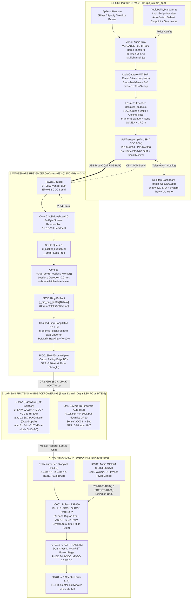
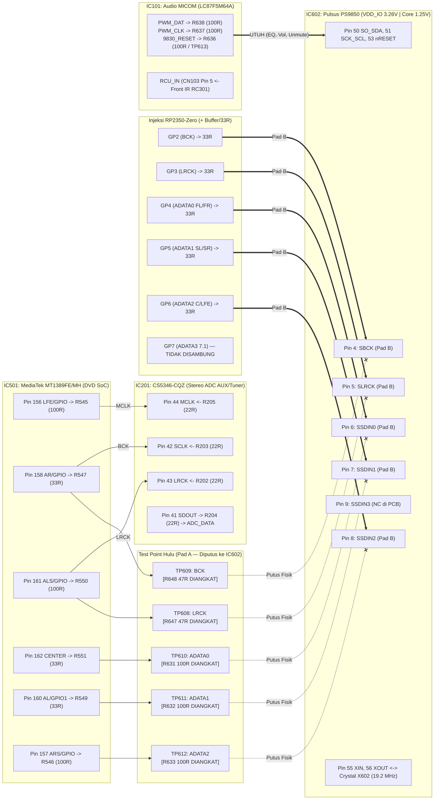
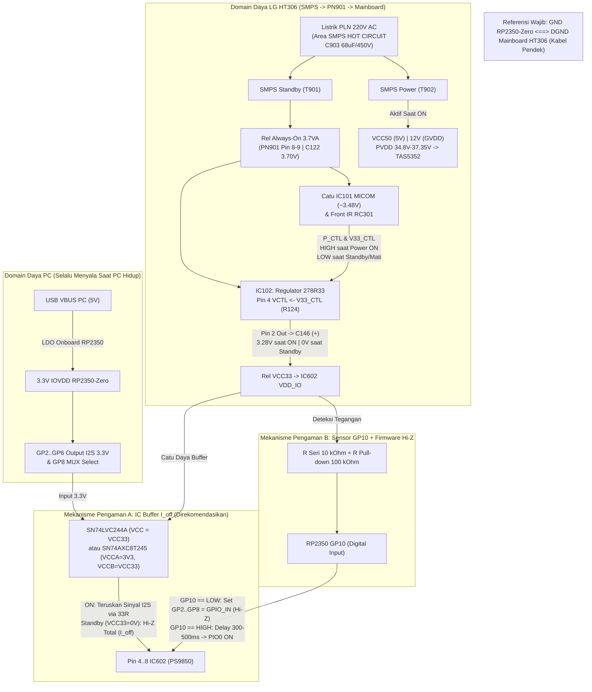
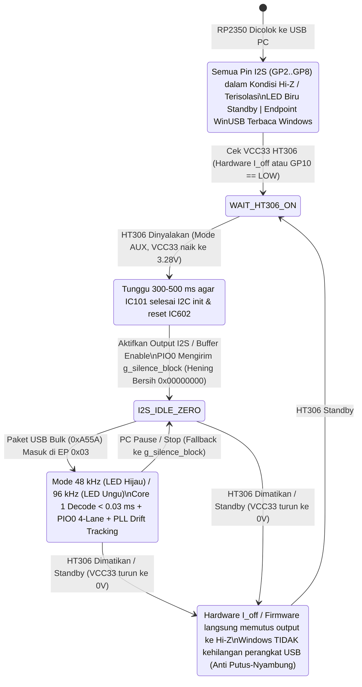
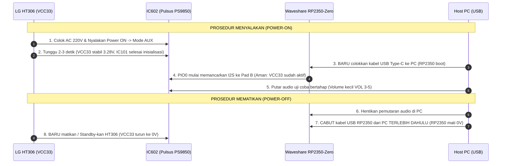

# 7. Arsitektur Utuh & Topologi Lengkap Sistem LG HT306 Direct-I2S

🌐 **Bahasa:** [English](./07_Complete_Architecture_and_Topology.md) | **Bahasa Indonesia**

[⬅️ Kembali ke README Utama](../README.id.md) | [Hardware & Mod Guide](./01_Hardware_Architecture_and_Mod_Guide.id.md) | [Codec 96 kHz](./02_Lossless_96kHz_Codec_Specification.id.md) | [PIO 4-Lane & DMA](./03_PIO_4Lane_I2S_and_DualCore_DMA.id.md) | [PC Audio Bridge PRD](./05_PC_Audio_Bridge_PRD_and_Architecture.id.md) | [Topologi Audio JRiver](./06_JRiver_Audio_Data_Topology.id.md) | [Kredit & Stack Teknologi](./08_Credits_and_Acknowledgments.id.md)

Dokumen ini menyajikan gambaran **end-to-end** seluruh sistem — mulai dari aplikasi audio di Windows 10/11, transport USB pada `Waveshare RP2350-Zero`, lapisan proteksi **Anti-Backpowering**, hingga skematik aktual mainboard **LG HT306PD (`EAX63554302`)** berdasarkan verifikasi *Service Manual* resmi.

---

## 7.1. Topologi Sistem Utuh (*End-to-End Hardware & Software Architecture*)

Diagram berikut memetakan aliran sinyal audio 6-kanal (`FL, FR, C, LFE, SL, SR`), jalur kontrol/telemetri, dan batas pemisahan catu daya dari PC hingga ke 6 speaker.

---

## 7.2. Topologi Skematik Mainboard (`IC501` ↔ `IC201` ↔ Titik Injeksi `IC602`)

Berdasarkan verifikasi skematik *LG HT306PD Service Manual* (`MAIN & AMP (#1)` & `(#2)`), terdapat **dua kelompok resistor seri** di jalur I2S. Resistor yang **wajib diangkat** adalah lima resistor di sisi **`IC602` (`R648, R647, R631, R632, R633`)** agar ADC **`IC201 (CS5346)`** tetap terisolasi bersama `IC501`.

> **Catatan Penting Skematik:**
> * Jika menggunakan mode Dual-Mode (`74LVC157`), input `A` (sinyal DVD asli) dapat diambil dari **`TP609`, `TP608`, `TP610`, `TP611`, `TP612`** atau sisi `Pad A` bekas `R648..R633` (dibutuhkan **2× `74LVC157`** untuk 5 jalur).
> * **`GP9` (`REMOCON_TX`)** pada [ht306_control.h](file:///e:/Project/HomeTheather/firmware/include/ht306_control.h#L15) dibiarkan belum disambungkan pada injeksi awal karena jalur `RCU_IN` terhubung ke rel standby `3.7VA`.

---

## 7.3. Topologi Kelistrikan, Domain Daya, & Mekanisme Anti-Backpowering

Diagram di bawah menjelaskan akar masalah *back-powering* (rel `VCC33` turun ke `0V` saat HT306 Standby/Mati sementara RP2350-Zero tetap mendapat `5V` dari USB PC) dan bagaimana dua mekanisme pengaman menutup celah tersebut.

---

## 7.4. Diagram State Operasional Aman (Power Sequencing)

---

## 7.5. Tabel Referensi Cepat Meja Kerja (Pinout, Komponen, & Titik Ukur)

| Jalur / Sinyal | Pin `RP2350-Zero` | Resistor Proteksi | Komponen Asli PCB `EAX63554302` (Diangkat) | Test Point Hulu (`Pad A`) | Tujuan di `IC602 (PS9850)` (`Pad B`) |
| :--- | :---: | :---: | :--- | :---: | :--- |
| **`I2S_BCK`** | `GP2` | `33 Ω` seri | **`R648`** (`47 Ω`) | `TP609` | **Pin 4** (`SBCK`) |
| **`I2S_LRCK`** | `GP3` | `33 Ω` seri | **`R647`** (`47 Ω`) | `TP608` | **Pin 5** (`SLRCK`) |
| **`I2S_ADATA0`** (`FL/FR`) | `GP4` | `33 Ω` seri | **`R631`** (`100 Ω`) | `TP610` | **Pin 6** (`SSDIN0`) |
| **`I2S_ADATA1`** (`SL/SR`) | `GP5` | `33 Ω` seri | **`R632`** (`100 Ω`) | `TP611` | **Pin 7** (`SSDIN1`) |
| **`I2S_ADATA2`** (`C/LFE`) | `GP6` | `33 Ω` seri | **`R633`** (`100 Ω`) | `TP612` | **Pin 8** (`SSDIN2`) |
| **Sense `VCC33` *(Opsi B)*** | `GP10` | `10 kΩ` seri + `100 kΩ` ke `GND` | *(Tidak mengangkat resistor)* | — | Kaki **`+` `C146`** / **`IC102` Pin 2** (`3.28V` ON / `0V` Standby) |
| **`MUX_SELECT` *(Opsi Dual-Mode)*** | `GP8` | Pull-down `10 kΩ` ke `GND` | *(Pakai 2× `74LVC157`, catu `VCC33`)* | — | Pin `Select` kedua IC `74LVC157` |
| **Ground Bersama** | `GND` | Kabel pendek tebal | Titik `DGND` dekat `IC602` | — | Referensi bersama **wajib disolder lebih dulu** |
| **Tidak Dipakai** | `GP7`, `GP9` | — | Pin 9 `IC602` (`SSDIN3`) NC; `RCU_IN` pada `3.7VA` | — | **Jangan disambung** saat injeksi I2S awal |

---

## 7.6. Panduan Pengujian Meja Kerja Sementara (*Bench Testing Direct Injection*)

Untuk pengujian awal sebelum rangkaian proteksi `SN74LVC244A` dipasang permanen, penyambungan langsung `GP2..GP6` ke `Pad B` dapat dijalankan secara aman dengan mengikuti panduan ketat berikut:

### 7.6.1. Aturan Pengkabelan & Resistor Seri
* **Wajib Gunakan Resistor Seri:** Sisipkan resistor **`33 Ω – 100 Ω`** di antara pin `GP2..GP6` dan `Pad B` (misal: `47 Ω` untuk clock `GP2/GP3` dan `100 Ω` untuk data `GP4..GP6`). Jangan pernah menggunakan kawat jumper polos `0 Ω`.
* **Kabel Pendek:** Panjang kawat jumper serabut maksimal **≤ 10 cm** dan seragam.
* **GND Lebih Dahulu:** Solder `GND` `RP2350-Zero` ke `DGND` HT306 sebelum menghubungkan jalur sinyal.

### 7.6.2. Urutan Daya Manual Wajib (*Manual Power Sequencing*)
Karena mesin `PIO0` pada RP2350 memancarkan detak clock aktif `BCK/LRCK` (`3,3V`) begitu dicolok ke PC, urutan berikut **wajib dipatuhi tanpa boleh terbalik**:

> [!CAUTION]
> Jangan pernah mematikan HT306 saat USB RP2350 masih dicolok ke PC, dan jangan menyalakan USB PC saat HT306 masih mati/standby. Kelalaian urutan dapat menyebabkan tegangan `3,3V` dari RP2350 merembes masuk ke `IC602` yang sedang tidak berdaya (*parasitic back-powering*).
