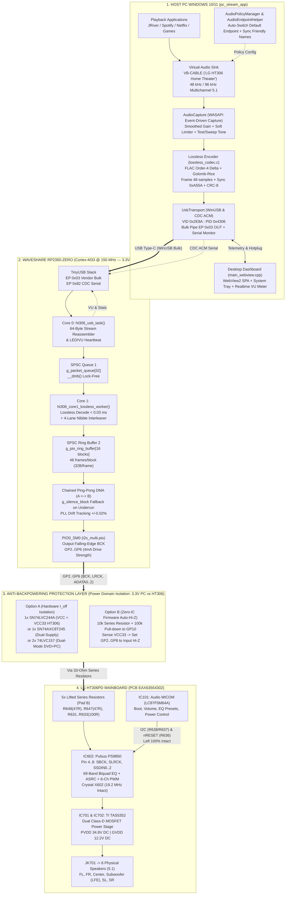
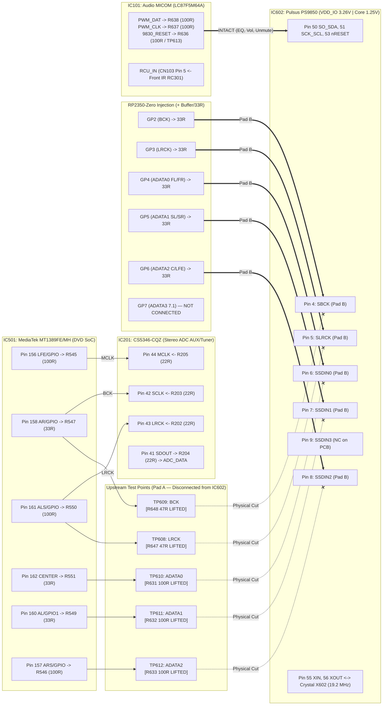
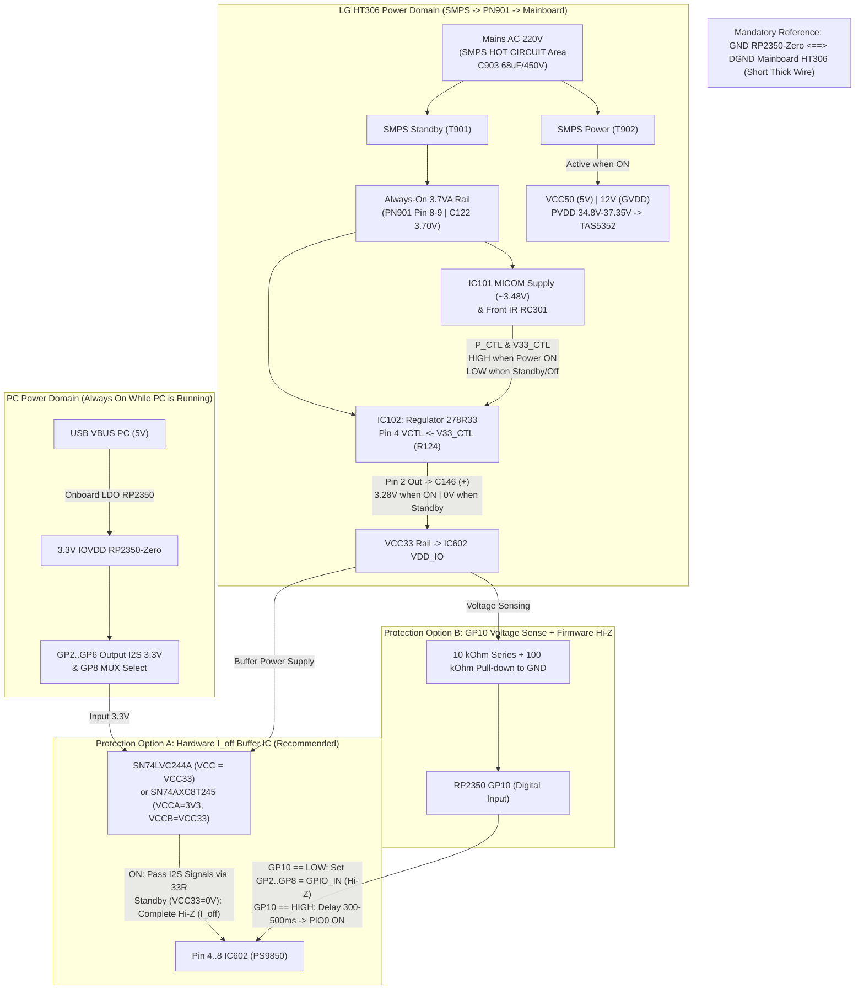
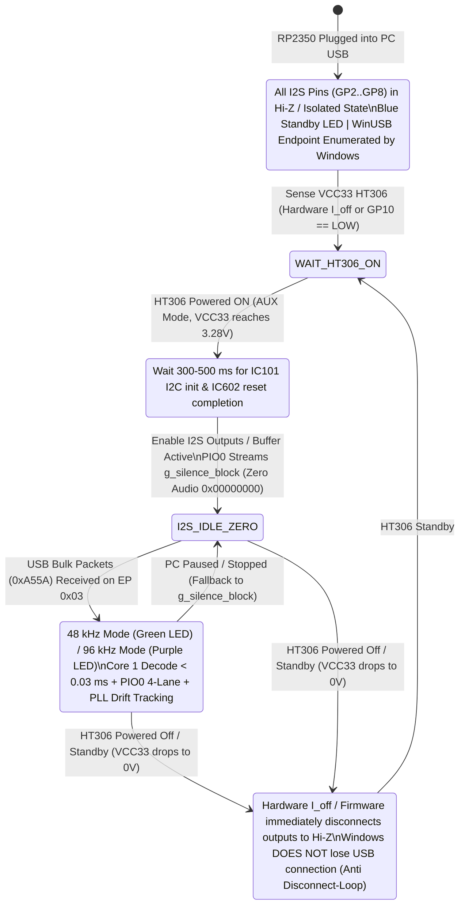
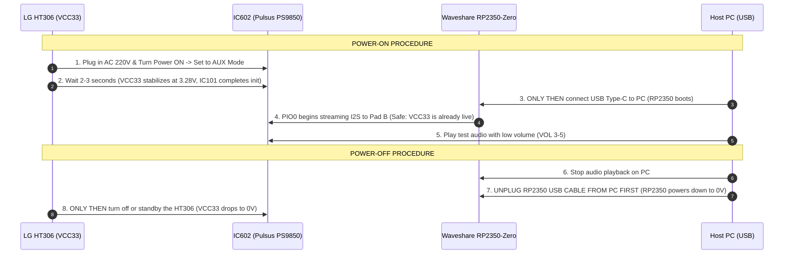

# 7. Complete System Architecture & End-to-End Topology (LG HT306 Direct-I2S)

🌐 **Language:** **English** | [Bahasa Indonesia](./07_Complete_Architecture_and_Topology.id.md)

[⬅️ Back to Main README](../README.md) | [Hardware & Mod Guide](./01_Hardware_Architecture_and_Mod_Guide.md) | [Codec 96 kHz](./02_Lossless_96kHz_Codec_Specification.md) | [PIO 4-Lane & DMA](./03_PIO_4Lane_I2S_and_DualCore_DMA.md) | [PC Audio Bridge PRD](./05_PC_Audio_Bridge_PRD_and_Architecture.md) | [JRiver Audio Topology](./06_JRiver_Audio_Data_Topology.md) | [Credits & Tech Stack](./08_Credits_and_Acknowledgments.md)

This document provides a comprehensive **end-to-end** overview of the entire system — covering Windows 10/11 host audio routing, USB transport on the `Waveshare RP2350-Zero`, the **Anti-Backpowering** electrical protection layer, and actual schematics of the **LG HT306PD (`EAX63554302`)** mainboard based on official *Service Manual* verification.

---

## 7.1. End-to-End System Topology (Hardware & Software Architecture)

The following diagram maps the 6-channel audio signal flow (`FL, FR, C, LFE, SL, SR`), control/telemetry pathways, and power domain boundaries from the PC down to the 6 physical speakers:

---

## 7.2. Mainboard Schematic Topology (`IC501` ↔ `IC201` ↔ `IC602` Injection Point)

Based on official schematic verification from the *LG HT306PD Service Manual* (`MAIN & AMP (#1)` & `(#2)`), there are **two groups of series damping resistors** along the I2S signal traces. The resistors that **must be desoldered/lifted** are the five resistors directly in front of **`IC602` (`R648, R647, R631, R632, R633`)** so that the ADC **`IC201 (CS5346)`** remains safely isolated alongside `IC501`.

> **Crucial Schematic Notes:**
> * For Dual-Mode setups (`74LVC157`), Input `A` (stock DVD signal) can be tapped from **`TP609`, `TP608`, `TP610`, `TP611`, `TP612`** or `Pad A` of lifted `R648..R633` (requires **2× `74LVC157`** ICs for 5 lines).
> * **`GP9` (`REMOCON_TX`)** on `firmware/include/ht306_control.h` is left unconnected in the initial injection stage because the `RCU_IN` line connects to the `3.7VA` standby rail.

---

## 7.3. Electrical Topology, Power Domains, & Anti-Backpowering Protection

The diagram below highlights the root cause of *back-powering* (the `VCC33` rail drops to `0V` when HT306 is in Standby/Off while RP2350-Zero receives continuous `5V` from PC USB) and illustrates how two protection schemes prevent hardware damage:

---

## 7.4. Safe Power Sequencing State Machine

---

## 7.5. Workbench Quick Reference Table (Pinout, Parts, & Test Points)

| Line / Signal | Pin `RP2350-Zero` | Series Resistor | Original Component on PCB `EAX63554302` (Lifted) | Upstream Test Point (`Pad A`) | Target on `IC602 (PS9850)` (`Pad B`) |
| :--- | :---: | :---: | :--- | :---: | :--- |
| **`I2S_BCK`** | `GP2` | `33 Ω` series | **`R648`** (`47 Ω`) | `TP609` | **Pin 4** (`SBCK`) |
| **`I2S_LRCK`** | `GP3` | `33 Ω` series | **`R647`** (`47 Ω`) | `TP608` | **Pin 5** (`SLRCK`) |
| **`I2S_ADATA0`** (`FL/FR`) | `GP4` | `33 Ω` series | **`R631`** (`100 Ω`) | `TP610` | **Pin 6** (`SSDIN0`) |
| **`I2S_ADATA1`** (`SL/SR`) | `GP5` | `33 Ω` series | **`R632`** (`100 Ω`) | `TP611` | **Pin 7** (`SSDIN1`) |
| **`I2S_ADATA2`** (`C/LFE`) | `GP6` | `33 Ω` series | **`R633`** (`100 Ω`) | `TP612` | **Pin 8** (`SSDIN2`) |
| **Sense `VCC33` *(Option B)*** | `GP10` | `10 kΩ` series + `100 kΩ` to `GND` | *(Do not lift any resistor)* | — | **`+` Leg of `C146`** / **`IC102` Pin 2** (`3.28V` ON / `0V` Standby) |
| **`MUX_SELECT` *(Dual-Mode)*** | `GP8` | Pull-down `10 kΩ` to `GND` | *(Uses 2× `74LVC157`, powered by `VCC33`)* | — | Pin `Select` on both `74LVC157` ICs |
| **Common Ground** | `GND` | Short thick wire | `DGND` point near `IC602` | — | Common reference **must be soldered first** |
| **Not Connected** | `GP7`, `GP9` | — | Pin 9 `IC602` (`SSDIN3`) is NC; `RCU_IN` is on `3.7VA` | — | **Do not connect** during initial I2S setup |

---

## 7.6. Bench Testing Direct Injection Guidelines

For bench tests before the permanent `SN74LVC244A` buffer circuit is installed, direct connections from `GP2..GP6` to `Pad B` can be safely conducted under strict rules:

### 7.6.1. Wiring Rules & Series Damping Resistors
* **Mandatory Series Resistors:** Always insert **`33 Ω – 100 Ω`** damping resistors between `GP2..GP6` and `Pad B` (e.g., `47 Ω` for clocks `GP2/GP3` and `100 Ω` for data lines `GP4..GP6`). Never use raw `0 Ω` wire.
* **Short Leads:** Keep wire lengths uniform and **≤ 10 cm**.
* **GND Connection First:** Solder the `GND` line between `RP2350-Zero` and HT306 `DGND` prior to connecting any signal wires.

### 7.6.2. Strict Manual Power-On / Power-Off Sequence
Because the `PIO0` engine on the RP2350 begins outputting active `3.3V` clock signals as soon as it is plugged into the PC, the following sequence **must be obeyed without exception**:

> [!CAUTION]
> Never turn off or standby the HT306 while the RP2350 USB cable is still plugged into the PC, and never plug the USB cable in while the HT306 is off. Inverting this sequence will cause `3.3V` logic voltages from the RP2350 to backfeed into the unpowered `IC602` (*parasitic back-powering*), risking permanent silicon degradation.
